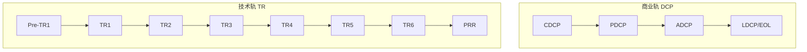

# DCP + TR 评审时序表

> 本表用于项目排期和门禁准备。具体检查项见各阶段 `checklists/`，材料模板见各阶段 `templates/`。

---

## 0. 一图看懂

> 读法：先看当前在哪个阶段，再看该阶段的 TR 要什么证据，最后看 DCP 要什么商业结论。

## 1. 总体时序

| 序号 | 节点 | 所属阶段 | 类型 | 建议时点 | 决策/评审人 | 通过后进入 |
|---:|---|---|---|---|---|---|
| 1 | **Pre-TR1** 概念技术预审 | 概念 | 技术预审 | CDCP 前 1~2 周 | 研发/架构/测试/质量/PQA | CDCP |
| 2 | **CDCP** 概念决策 | 概念 | 商业决策 | 概念阶段末 | IPMT | 计划阶段 |
| 3 | **TR1 准入预审** | 计划 | 技术预审 | PDCP 前 1~2 周 | 研发/架构/测试/质量/PQA | PDCP |
| 4 | **PDCP** 计划决策 | 计划 | 商业决策 | 计划阶段末 | IPMT/产品线 IPMT | 开发阶段 |
| 5 | **TR1** 需求与方案基线 | 开发 | 技术评审 | 开发入口 | 技术评审组 | 系统/详细设计 |
| 6 | **TR2** 系统设计与接口 | 开发 | 技术评审 | 系统设计完成 | 技术评审组 | 详细设计/实现 |
| 7 | **TR3** 详细设计与实现 | 开发 | 技术评审 | 详细设计完成 | 技术评审组 | 编码/集成 |
| 8 | **TR4** 开发完成与集成 | 开发 | 技术评审 | 集成测试完成 | 技术评审组 | 验证阶段 |
| 9 | **VRR** 验证准入 | 开发/验证 | 管理决策 | TR4 后 | PDT/IPMT 授权代表 | 验证阶段 |
| 10 | **TR5** 验证完成 | 验证 | 技术评审 | 验证完成 | 技术评审组 | 发布准备 |
| 11 | **LRR** 发布准入预审 | 验证/发布 | 管理预审 | TR5 后 | PDT/PQA/IPMT 授权代表 | TR6/ADCP |
| 12 | **TR6** 发布/量产就绪 | 发布 | 技术评审 | 发布前 | 技术评审组 | ADCP |
| 13 | **ADCP** 可获得性决策 | 发布 | 商业决策 | 发布前 | IPMT | 上市/量产 |
| 14 | **PRR** 上市后复盘 | 生命周期 | 管理复盘 | 上市后 3~6 个月 | 产品/PDT/PMO | 持续经营或 LDCP |
| 15 | **LDCP/EOL DCP** 退市决策 | 生命周期 | 商业决策 | 退市条件成立 | IPMT/产品线 IPMT | 退市执行 |

> **TR1 映射说明**：本体系按“开发阶段 TR1~TR4”组织。若公司采用“概念/计划阶段 TR1/TR2”的映射，保持节点目标、准入、准出和证据链不变即可。

---

## 2. 每个节点的输入/输出/证据

### 2.1 Pre-TR1 概念技术预审

| 项目 | 内容 |
|---|---|
| 输入 | 产品概念方案、初始需求、技术可行性初评、初始风险/合规/IP、目标成本初算 |
| 重点检查 | 关键技术路线是否可选；重大技术风险是否有验证计划；需求能否转成验收标准 |
| 输出 | 技术预审意见、TR1 待办、风险清单 |
| 证据 | 概念方案、可行性报告、风险登记册、专家意见 |
| 不通过 | 技术路线未收敛 → 回炉概念；关键依赖无法获得 → CDCP No-Go/Rework |

### 2.2 CDCP

| 项目 | 内容 |
|---|---|
| 输入 | 立项申请书、商业论证、市场/需求分析、概念方案、技术可行性、初始风险/合规/IP、成本估算、PDT 任命、裁剪表 |
| 重点检查 | 战略匹配、市场证据、商业价值、技术可行、风险可控、资源可承诺、合规无红线 |
| 输出 | CDCP 纪要（Go/Rework/No-Go）、条件、行动项 |
| 证据 | 立项申请书、商业论证、Pre-TR1 意见、风险/合规/IP 记录 |
| Rework | 限时补充（A 类 4 周、B 类 2 周、C 类 1 周） |
| No-Go | 机会关闭/观察，记录原因，避免重复立项 |

### 2.3 TR1 准入预审（计划阶段）

| 项目 | 内容 |
|---|---|
| 输入 | SRS 基线草案、架构初稿、测试策略、RTM、风险、资源/进度/成本计划 |
| 重点检查 | 需求完整/一致/可测试/可追溯；架构满足需求；测试策略覆盖；计划与预算匹配 |
| 输出 | TR1 预审意见、PDCP 技术分册 |
| 证据 | SRS、架构、RTM、测试策略、风险登记册 |
| 不通过 | 需求/架构未收敛 → 计划阶段 Rework，不得进入 PDCP |

### 2.4 PDCP

| 项目 | 内容 |
|---|---|
| 输入 | 项目主计划、WBS、进度、预算、SRS 基线、架构、质量计划、测试计划、供应/制造/服务计划、风险、资源、任务书 |
| 重点检查 | 需求/架构冻结、计划闭合、预算/资源获批、供应/制造/服务可行、Top 风险有应对、任务书签署 |
| 输出 | PDCP 纪要、项目任务书、基线清单 |
| 证据 | 主计划、WBS、预算、SRS 基线、架构、质量/测试/供应计划、风险登记册 |
| Rework | 计划不闭合/资源缺口/供应未就绪，限时整改 |
| No-Go | 商业假设失效/技术路线不可行/投入产出不达标 |

### 2.5 TR1 需求与方案基线

| 项目 | 内容 |
|---|---|
| 输入 | SRS 基线、架构草案、测试策略、RTM、风险、资源/进度 |
| 重点检查 | 需求完整/一致/可测试/可追溯；架构满足需求；关键接口定义；测试策略覆盖；变更受控 |
| 输出 | TR1 报告、问题清单、准入结论 |
| 证据 | SRS、架构、RTM、测试策略、评审意见闭环记录 |
| 不通过 | 问题未闭环 → 不得进入系统设计 |

### 2.6 TR2 系统设计与接口

| 项目 | 内容 |
|---|---|
| 输入 | 系统设计、接口规格、数据设计、非功能设计、原型/仿真 |
| 重点检查 | 设计覆盖需求；接口闭合；非功能可验证；DFM/DFT/DFS 初评；风险有应对 |
| 输出 | TR2 报告、接口问题清单、设计基线 |
| 证据 | 系统设计、接口规格、仿真/原型报告、DFM/DFT/DFS 初评 |
| 不通过 | 接口不闭合/非功能不可验证 → 回炉设计 |

### 2.7 TR3 详细设计与实现

| 项目 | 内容 |
|---|---|
| 输入 | 详细设计、模块/数据库设计、工艺、FMEA、测试用例 |
| 重点检查 | 设计可编码/可制造；关键特性受控；用例覆盖；变更影响分析完成 |
| 输出 | TR3 报告、详细设计基线、问题清单 |
| 证据 | 详细设计、FMEA、工艺文件、测试用例、变更影响分析 |
| 不通过 | 设计不可制造/用例覆盖不足 → 回炉详细设计 |

### 2.8 TR4 开发完成与集成

| 项目 | 内容 |
|---|---|
| 输入 | 代码/设计发布、单元/集成测试报告、样机、BOM、工艺、缺陷收敛 |
| 重点检查 | 集成通过；阻断缺陷清零；版本受控；文档齐套；验证准入 |
| 输出 | TR4 报告、验证准入建议、遗留问题清单 |
| 证据 | 测试报告、缺陷台账、版本记录、BOM/工艺、样机报告 |
| 不通过 | 阻断缺陷未清零/版本不受控 → 不得进入验证 |

### 2.9 VRR 验证准入

| 项目 | 内容 |
|---|---|
| 输入 | TR4 报告、版本冻结记录、验证资源/环境、缺陷收敛、剩余风险 |
| 重点检查 | TR4 通过；验证资源/环境就绪；版本冻结；Top 风险有应对 |
| 输出 | VRR 纪要、验证启动授权 |
| 证据 | TR4 报告、环境清单、版本记录、风险登记册 |
| 不通过 | 环境/资源未就绪 → 延期或调整验证计划 |

### 2.10 TR5 验证完成

| 项目 | 内容 |
|---|---|
| 输入 | 验证计划、测试报告、UAT/Beta、认证、试产、缺陷收敛、服务/文档 |
| 重点检查 | 测试覆盖达标；阻断/严重缺陷清零；性能/可靠性/安全/合规通过；试产良率达标；服务/文档/培训就绪；剩余风险可接受 |
| 输出 | TR5 报告、发布准入建议、遗留问题清单、剩余风险记录 |
| 证据 | 测试报告、认证证书、试产报告、缺陷台账、服务验证 |
| 不通过 | 关键缺陷未闭环/认证未完成/试产不达标 → 回炉验证/开发 |

### 2.11 LRR 发布准入预审

| 项目 | 内容 |
|---|---|
| 输入 | TR5 报告、发布准入评估、剩余风险、各领域就绪证据 |
| 重点检查 | 质量/合规达标；供应/制造/服务就绪；剩余风险可接受 |
| 输出 | LRR 纪要、TR6/ADCP 准备清单 |
| 证据 | 各领域就绪证据、风险接受记录 |
| 不通过 | 关键领域未就绪 → 延期发布或分阶段发布 |

### 2.12 TR6 发布/量产就绪

| 项目 | 内容 |
|---|---|
| 输入 | 发布计划、量产/交付、供应链备货、质量数据、认证、文档、服务、培训、回退 |
| 重点检查 | 所有发布门禁通过；首单/首台可交付；支持团队就绪；监控/回退就绪；剩余风险接受 |
| 输出 | TR6 报告、发布放行建议、遗留问题清单 |
| 证据 | 发布检查台账、量产/供应证据、服务/培训记录、回退演练 |
| 不通过 | 门禁未过 → 不得提交 ADCP |

### 2.13 ADCP

| 项目 | 内容 |
|---|---|
| 输入 | TR6 报告、发布计划、市场/销售/定价、量产/供应、服务、质量、认证、回退方案 |
| 重点检查 | 商业目标成立；质量/成本/进度达标；量产/交付就绪；市场/销售/服务就绪；合规；回退方案批准 |
| 输出 | ADCP 纪要、上市授权、发布范围/时间 |
| 证据 | TR6 报告、发布计划、定价方案、供应/服务证据、回退方案 |
| Rework | 上市准备不足/良率不达标/支持未就绪 → 限时整改或分阶段发布 |
| No-Go | 质量/合规红线/商业假设失效/供应链断裂 → 延迟或取消 |

### 2.14 PRR 上市后复盘

| 项目 | 内容 |
|---|---|
| 输入 | 绩效数据、质量数据、客户反馈、问题闭环、成本数据 |
| 重点检查 | 目标达成、问题闭环、改进计划、是否触发 LDCP |
| 输出 | PRR 报告、改进计划、LDCP 触发建议 |
| 证据 | 绩效台账、客户反馈、质量报告、财务数据 |
| 不通过 | 未达目标 → 制定改进计划；持续恶化 → 启动 EOL 评估 |

### 2.15 LDCP/EOL DCP

| 项目 | 内容 |
|---|---|
| 输入 | 退市评估、退市计划、客户迁移方案、库存/服务/合同影响、财务影响 |
| 重点检查 | 退市条件成立；客户迁移可行；库存/服务/合同风险可控；财务影响可接受 |
| 输出 | LDCP/EOL 纪要、退市授权、执行计划 |
| 证据 | EOL 评估、迁移方案、库存/服务计划、财务测算 |
| Rework | 迁移/库存/客户影响未闭环 → 限时整改 |
| No-Go | 客户/合同/合规风险不可接受 → 延后退市 |

---

## 3. 门禁材料清单（按节点）

| 节点 | 必备材料 | 条件材料 |
|---|---|---|
| Pre-TR1 | 概念方案、初始需求、技术可行性、风险/合规/IP、成本初算 | 原型/仿真、竞品、IP 检索 |
| CDCP | 立项申请书、商业论证、市场/需求、概念方案、技术可行性、风险/合规/IP、成本、PDT 任命、裁剪表 | 竞品、IP 初评、主计划初稿 |
| TR1 预审 | SRS 草案、架构初稿、测试策略、RTM、风险、资源/进度/成本 | 原型、采购/供应计划 |
| PDCP | 主计划、WBS、进度、预算、SRS 基线、架构、质量/测试/供应/制造/服务计划、风险、任务书 | 合规/安全/IP 计划、试产计划 |
| TR1 | SRS 基线、架构、测试策略、RTM、风险、变更记录 | 原型、竞品 |
| TR2 | 系统设计、接口规格、数据/非功能设计、原型/仿真 | 备选方案、容量模型 |
| TR3 | 详细设计、模块/数据库、工艺、FMEA、测试用例 | 代码规范、仿真 |
| TR4 | 代码/设计发布、单元/集成测试、样机、BOM、工艺、缺陷收敛 | 自动化、性能 |
| VRR | TR4 报告、版本冻结、验证资源/环境、缺陷收敛、剩余风险 | 验证计划 |
| TR5 | 验证计划、测试报告、UAT/Beta、认证、试产、缺陷收敛、服务/文档 | 性能/安全/可靠性专项 |
| LRR | TR5 报告、发布准入评估、剩余风险、各领域就绪证据 | 渠道/媒体准备 |
| TR6 | 发布计划、量产/供应、质量、认证、文档、服务、培训、回退 | 渠道/媒体 |
| ADCP | TR6 报告、发布计划、定价、供应/服务、质量、认证、回退 | 财务跟踪 |
| PRR | 绩效、质量、客户反馈、成本 | 竞品/市场 |
| LDCP/EOL | EOL 评估、退市计划、迁移方案、库存/服务/合同、财务 | 多语言通知 |

---

## 4. 时限与升级

| 事项 | 时限 | 超时升级 |
|---|---|---|
| DCP 材料提交 | 会前 5 个工作日 | PMO → IPMT 秘书 |
| TR 材料提交 | 会前 3~5 个工作日 | PQA → PDT 经理 |
| 评审意见闭环 | 5 个工作日内 | PQA → PDT 经理 |
| 阻断问题闭环 | 进入下一阶段前 | PDT 经理 → IPMT |
| 认证/供应风险 | 按项目计划 | SCM/QA → PDT 经理 → IPMT |
| 重大变更 | 24 小时内评估 | CCB → IPMT |

> 任何节点不得以“先过会、后补材料”方式绕过门禁；确需紧急决策的，走例外审批并记录风险。
