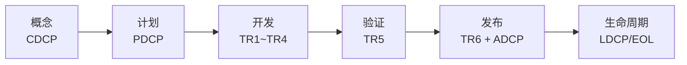

# IPD 全流程总览

> 本文说明 IPD 六阶段、DCP/TR 双轨、阶段门禁、角色和交付物的整体关系。具体模板见各阶段目录。

---

## 0. 一图看懂



| 颜色 | 含义 | 处理 |
|---|---|---|
| 🔴 | 红线 | 质量/合规/安全/IP 一票否决，不得特批 |
| 🟡 | 有条件通过 | 整改计划 + 替代控制 + 书面批准 |
| 🟢 | 通过 | 证据齐全、问题闭环、基线冻结 |

## 1. IPD 的核心逻辑

IPD（Integrated Product Development，集成产品开发）不是“把开发流程画长”，而是用**阶段门禁**回答四个问题：

1. **做不做**：市场/商业价值是否成立？（CDCP）
2. **怎么做、投多少**：计划、资源、预算是否闭合？（PDCP）
3. **做出来的对不对**：设计、开发、验证是否达标？（TR1~TR5）
4. **卖不卖、怎么交付**：量产、供应、服务、市场是否就绪？（TR6 + ADCP）

每个阶段都必须同时通过**商业决策（DCP）**和**技术评审（TR）**，两条轨道不能互相替代：

- DCP 关注：战略匹配、商业价值、投资回报、资源承诺、上市/退市时机；
- TR 关注：需求、架构、设计、开发、验证、发布的技术成熟度和风险。

---

## 2. 六阶段与门禁

| 阶段 | 目标 | 商业决策 | 技术评审 | 进入下一阶段的条件 |
|---|---|---|---|---|
| **概念 Concept** | 把机会点变成可立项的产品概念 | **CDCP** | Pre-TR1（概念技术预审） | 商业价值成立、技术可行、风险可控、资源可承诺 |
| **计划 Plan** | 把概念变成可执行计划 | **PDCP** | TR1 准入预审 | 需求/架构基线、计划/预算/资源闭合、任务书签署 |
| **开发 Development** | 按基线完成设计、开发、集成 | 无独立 DCP（重大变更触发 IDCP） | **TR1~TR4** | 设计完成、集成通过、阻断缺陷清零、验证准入 |
| **验证 Validation** | 证明产品满足需求/质量/合规 | 无独立 DCP（LRR 发布准入预审） | **TR5** | 测试通过、缺陷收敛、认证/试产/服务就绪 |
| **发布 Release** | 完成上市/量产/交付准备 | **ADCP** | **TR6** | 发布门禁全过、首单可交付、回退就绪 |
| **生命周期/退市 Lifecycle** | 监控绩效、持续优化、平稳退市 | **LDCP/EOL DCP** | PRR（上市后复盘） | 绩效达标或退市条件成立、迁移/库存/服务可控 |

---

## 3. DCP 与 TR 的关系

### 3.1 双轨并行

```text
商业轨：  CDCP ───────── PDCP ─────────────── ADCP ───── LDCP/EOL DCP
             │              │                    │              │
技术轨：  Pre-TR1 ─────── TR1 ─ TR2 ─ TR3 ─ TR4 ─ TR5 ─ TR6 ─ PRR
```

- **DCP 不能替代 TR**：商业上可行，不代表技术方案成熟；
- **TR 不能替代 DCP**：技术通过，不代表值得投资或可以上市；
- **DCP 决策必须引用 TR 结论**：TR 未通过，DCP 原则上不得 Go；
- **TR 发现重大商业影响**（成本、进度、范围），必须回到 DCP/CCB。

### 3.2 决策权限

| 决策 | 决策人 | 材料提交 | 纪要 |
|---|---|---|---|
| CDCP | IPMT（A 类全体；B 类产品线 IPMT；C 类授权） | 提前 5 个工作日 | 24 小时内 |
| PDCP | IPMT/产品线 IPMT | 提前 5 个工作日 | 24 小时内 |
| ADCP | IPMT | 提前 5 个工作日 | 24 小时内 |
| LDCP/EOL DCP | IPMT/产品线 IPMT | 提前 5 个工作日 | 24 小时内 |
| TR1~TR6 | 技术评审组（研发/架构/测试/质量/供应链/服务/PQA） | 提前 3~5 个工作日 | 评审当天 |

---

## 4. 各阶段关键输入/输出

### 4.1 概念阶段（CDCP）

**输入**：机会点、战略/路标、客户/市场调研、初步需求、合规初筛。

**核心活动**：
- 市场/客户需求分析；
- 商业论证（市场空间、收入、成本、ROI）；
- 产品概念与技术可行性；
- 初始风险/合规/IP/成本评估；
- PDT 组建与立项申请。

**输出**：立项申请书、商业论证、初始 SRS、概念方案、技术可行性、初始风险/成本、PDT 任命、CDCP 材料。

**Go 的关键**：目标客户/场景清晰、商业价值成立、技术可行、风险可控、资源可承诺、合规无红线。

---

### 4.2 计划阶段（PDCP）

**输入**：CDCP Go、立项申请书、初始需求/概念方案。

**核心活动**：
- 需求基线、架构基线；
- WBS、进度、资源、预算；
- 质量/测试/供应/制造/服务计划；
- 风险、变更、配置、度量机制；
- 项目任务书。

**输出**：项目主计划、WBS、SRS 基线、架构、质量计划、测试计划、成本预算、供应/制造/服务计划、PDCP 材料。

**Go 的关键**：需求/架构冻结、计划闭合、预算/资源获批、供应/制造/服务可行、Top 风险有应对、任务书签署。

---

### 4.3 开发阶段（TR1~TR4）

**输入**：PDCP Go、需求/架构基线、项目任务书。

**核心活动**：
- 系统需求、系统设计、接口设计；
- 详细设计、DFMEA/PFMEA、工艺/BOM；
- 编码/实现、单元/集成测试；
- 样机试制、设计变更、缺陷闭环。

**TR 节点**：

| TR | 主题 | 核心问题 |
|---|---|---|
| TR1 | 需求与方案基线 | 需求是否完整、可测试、可追溯？架构是否满足需求？ |
| TR2 | 系统设计与接口 | 接口是否闭合？非功能是否可验证？DFM/DFT/DFS 是否初评？ |
| TR3 | 详细设计与实现 | 设计是否可编码/可制造？关键特性是否受控？用例是否覆盖？ |
| TR4 | 开发完成与集成 | 集成是否通过？阻断缺陷是否清零？版本/文档是否受控？ |

**输出**：系统/详细设计、接口规格、DFMEA、单元/集成测试报告、样机报告、BOM、工艺文件、TR1~TR4 材料。

---

### 4.4 验证阶段（TR5）

**输入**：TR4 通过、候选版本/样机、验证计划。

**核心活动**：
- 系统测试、性能/可靠性/安全测试；
- UAT/Beta/试点；
- 认证/安规/EMC；
- 试产/小批量验证；
- 缺陷收敛、质量度量、服务/文档验证。

**输出**：验证测试报告、UAT/Beta 报告、认证报告、试产报告、缺陷收敛报告、TR5 材料、发布准入评估、剩余风险接受记录。

**TR5 准出**：测试覆盖达标、阻断/严重缺陷清零、性能/可靠性/安全/合规通过、试产良率达标、服务/文档/培训就绪、剩余风险可接受。

---

### 4.5 发布阶段（TR6 + ADCP）

**输入**：TR5 通过、发布包/版本冻结、量产/交付准备。

**核心活动**：
- 发布计划、市场推广、销售/渠道、定价；
- 生产爬坡、供应链备货、服务/备件/培训；
- 发布风险评估与回退方案；
- TR6、ADCP。

**输出**：发布计划、上市计划、定价方案、量产/供应计划、服务准备、Release Notes、产品手册、回退方案、TR6 材料、ADCP 材料、发布后监控计划。

**ADCP Go 的关键**：商业目标成立、质量/成本/进度达标、量产/交付就绪、市场/销售/服务就绪、合规、回退方案批准。

---

### 4.6 生命周期/退市阶段（LDCP/EOL）

**输入**：ADCP Go/产品上市、绩效/质量/客户数据。

**核心活动**：
- 绩效监控（收入、毛利、销量、份额、质量、满意度）；
- 版本迭代/降本/合规维护；
- 退市评估、客户迁移、库存处置、服务终止；
- 项目复盘、知识沉淀。

**输出**：绩效报告、满意度/质量报告、EOL 评估、退市计划、迁移方案、服务终止计划、归档清单、复盘报告、LDCP/EOL 材料。

**LDCP/EOL Go 的关键**：退市条件成立、客户迁移可行、库存/服务/合同风险可控、财务影响可接受。

---

## 5. 阶段门禁的通用规则

1. **材料不全不上会**：DCP/TR 材料必须提前提交，PQA/PMO 预审；
2. **问题不闭环不晋级**：阻断/严重问题必须有责任人和期限，未闭环不得进入下一阶段；
3. **红线一票否决**：质量、合规、安全、IP 红线不得“特批”；
4. **决策留痕**：DCP/TR 必须形成纪要，明确 Go/Rework/No-Go、条件、行动项；
5. **变更受控**：范围/进度/成本/设计变更必须走 CCB，重大变更触发临时 DCP；
6. **裁剪可审计**：所有裁剪记录在《项目裁剪表》，PQA 审核。

---

## 6. 常见失败模式

| 失败模式 | 表现 | 纠正 |
|---|---|---|
| 把 TR 开成“汇报会” | 只讲进度，不查证据；问题不闭环 | 用 Checklist 逐项判定，结论必须附证据 |
| DCP 被技术细节淹没 | 讨论设计，忽略商业价值/投资回报 | DCP 材料先讲决策请求和商业结论，技术放附录 |
| 需求基线形同虚设 | 开发中随意加需求 | RTM + 变更控制 + CCB |
| 风险登记册变成“摆设” | 只列风险，不写应对/责任人 | Top 风险每周复盘，触发条件明确 |
| 验证阶段才发现问题 | 设计缺陷留到 TR5 | TR1~TR4 逐级门禁，DFMEA/DFT 前置 |
| 发布前“救火” | 认证/供应/服务未就绪 | TR6 门禁 + ADCP 前 LRR 预审 |
| 退市“一关了之” | 客户无迁移、库存积压、服务断档 | EOL 评估 + 迁移方案 + 库存/服务计划 |

---

## 7. 相关文件

- [DCP/TR 时序表](DCP与TR时序.md)
- [角色 RACI](角色与RACI.md)
- [文件等级指南](文件分级与裁剪指南.md)
- [项目分级与裁剪](项目分级与裁剪.md)
- [全量交付物索引](全量交付物索引.md)
