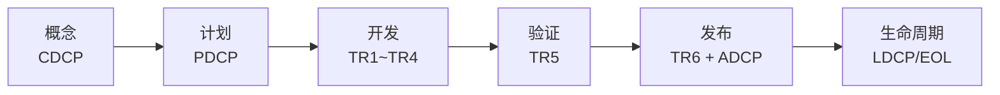
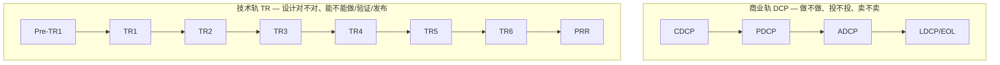
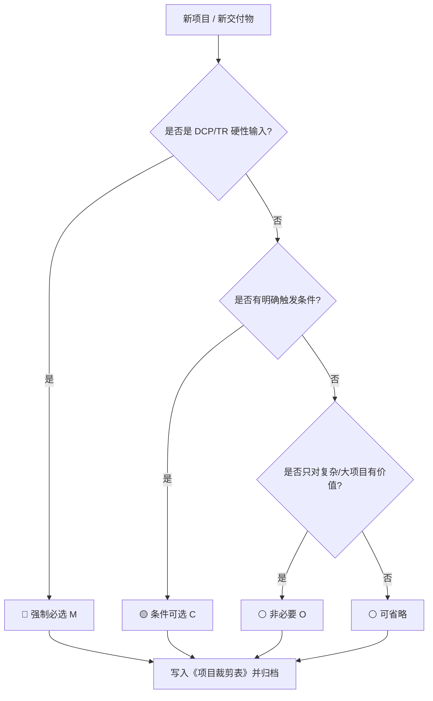

# 一页看懂 IPD

> 先看图，再看表，最后才看正文。GitHub、VS Code（Markdown Preview Mermaid 插件）可直接渲染下面的图。

---

## 1. 六阶段一张图

**一句话**：概念决定“做不做”，计划决定“怎么做”，开发决定“做不做得出来”，验证决定“对不对”，发布决定“卖不卖”，生命周期决定“继续还是退”。

---

## 2. DCP / TR 双轨图

**记住**：DCP 不能替代 TR，TR 也不能替代 DCP；TR 未通过，DCP 原则上不得 Go。

---

## 3. 三色门禁

| 颜色 | 含义 | 处理规则 |
|---|---|---|
| 🔴 红线 | 质量/合规/安全/IP 一票否决 | 不得特批；必须整改或终止 |
| 🟡 有条件通过 | 有整改计划 + 替代控制 + 书面批准 | 限期闭环；未闭环不得进入下一阶段 |
| 🟢 通过 | 证据齐全、问题闭环、责任人明确 | 进入下一阶段，基线冻结 |

---

## 4. 裁剪决策树

**三条红线**：DCP/TR 硬性输入不得裁；质量/成本/风险/验收/升级路径不得整体省；裁剪必须有替代控制。

---

## 5. 十条铁律

| # | 铁律 | 一句话解释 |
|---:|---|---|
| 1 | 🎯 先结论后证据 | 每份材料开头先写“要决策什么、结论是什么” |
| 2 | 🔴 红线不特批 | 质量/合规/安全/IP 没有“下不为例” |
| 3 | 🚦 问题不闭环不晋级 | 阻断/严重问题必须有责任人和期限 |
| 4 | 📊 台账不覆盖历史 | 变更留痕，状态流转可追溯 |
| 5 | 🧾 决策必留纪要 | Go/Rework/No-Go + 条件 + 行动项 |
| 6 | 🔄 变更必走 CCB | 重大变更触发临时 DCP |
| 7 | 🧩 接口必须闭合 | “待定”不是接口，是风险 |
| 8 | 🧪 验证前置 | DFM/DFT/DFS/FMEA 不要留到 TR5 |
| 9 | 📦 发布看全链路 | 质量、供应、制造、服务、回退一起看 |
| 10 | 📚 退市也要复盘 | 客户迁移、库存、服务、知识归档 |

---

## 6. 物料地图

| 阶段 | 文件夹 | 门禁 | 物料数 | 先看什么 |
|---|---|---|---:|---|
| 概念 | `01-概念阶段-CDCP/` | CDCP + Pre-TR1 | 25 | 立项申请书、CDCP 检查表 |
| 计划 | `02-计划阶段-PDCP/` | PDCP + TR1 预审 | 38 | 项目主计划、SRS 基线、PDCP 检查表 |
| 开发 | `03-开发阶段-TR1-TR4/` | TR1~TR4 + VRR | 51 | TR1~TR4 检查表、设计/测试模板 |
| 验证 | `04-验证阶段-TR5/` | TR5 + LRR | 33 | TR5 检查表、发布准入评估 |
| 发布 | `05-发布阶段-TR6-ADCP/` | TR6 + ADCP | 35 | TR6 检查表、ADCP 材料、回退方案 |
| 生命周期 | `06-生命周期与退市/` | PRR + LDCP/EOL | 29 | 绩效报告、EOL 评估、复盘 |
| 治理 | `07-顶层治理/` | 跨项目 | 43 | 变更/风险/基线/PQA SOP |
| 公共 | `08-公共模板与规范/` | 全流程 | 24 | 会议纪要、风险台账、裁剪表 |

---

## 7. 先看这几份

1. [IPD流程总览.md](IPD流程总览.md) — 六阶段和门禁的完整说明；
2. [DCP与TR时序.md](DCP与TR时序.md) — 每个节点什么时候开、要什么材料；
3. [文件分级与裁剪指南.md](文件分级与裁剪指南.md) — 哪些必须做、哪些可以省；
4. [全量交付物索引.md](全量交付物索引.md) — 278 份交付物的完整清单。

> 如果只记一句话：**每个阶段先看“门禁 + 检查表”，再决定“模板填多细”。**
