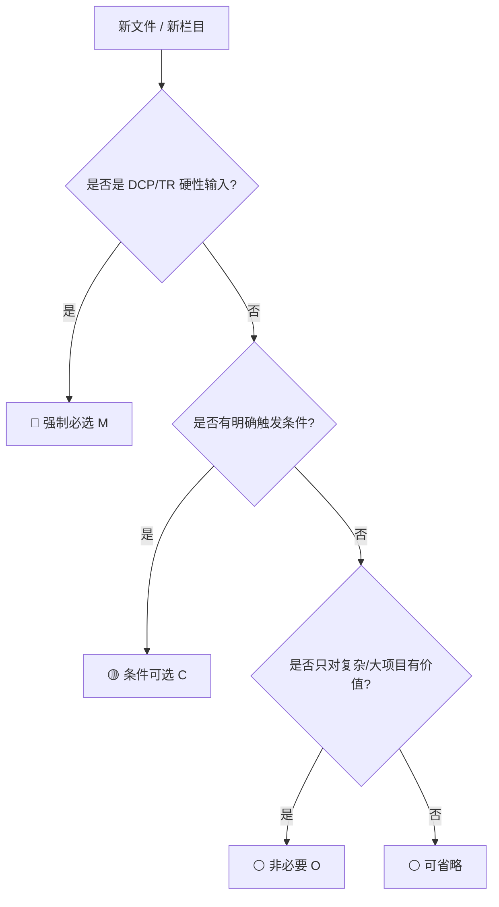

# 文件等级与模板栏目分级指南

> IPD 落地最常见的两个极端：**所有项目写全套**（累死团队）和 **所有项目都简化**（门禁失控）。本指南解决“文件本身要不要做”和“模板内部写多细”两个问题。

---

## 0. 一图看懂



> 先判断“文件要不要做”，再判断“模板内部写多细”；两层都分级，才叫弹性管控。

## 1. 两个层级的分级

### 1.1 第一层：文件本身要不要产出

| 等级 | 代码 | 判定标准 | 不产出的后果 | 批准 |
|---|---|---|---|---|
| 强制必选 | **M** | 不产出则 DCP/TR 不得进入或不得通过；审计/合规硬要求 | 门禁不通过 | 无例外；确需例外走《例外审批表》 |
| 条件可选 | **C** | 满足括号内场景才需要；不适用时记录理由 | 需在《项目裁剪表》说明 | PQA 审核 + PDT 经理批准 |
| 非必要 | **O** | 仅 A 类/复杂/高风险项目增值；B/C 类可省略 | 不影响门禁 | PDT 经理批准即可 |

### 1.2 第二层：模板内部栏目写多细

| 分级 | 含义 | 处理规则 |
|---|---|---|
| **核心必填** | 缺了就不能判“完成”；DCP/TR 必须看 | 不得删除；不适用写“不适用 + 理由” |
| **推荐填写** | 有则显著提升质量；复杂项目建议保留 | 可简化；C 类项目可合并 |
| **可省略** | 仅特定场景/大项目增值 | 可直接不写；不影响门禁 |

---

## 2. 怎么判断一份文件是 M/C/O

按以下顺序判断：

1. **是否是 DCP/TR 的硬性输入？** 是 → M。
2. **是否涉及质量/合规/安全/IP 红线？** 是 → M。
3. **是否是跨部门协同/资源承诺的必要证据？** 是 → M 或 C（看项目级别）。
4. **是否有明确触发条件？** 有 → C（括号内写触发条件）。
5. **是否只对复杂/大项目有价值？** 是 → O。
6. **是否只是“锦上添花”且不影响决策？** 是 → O。

### 2.1 判定示例

| 文件 | 等级 | 理由 |
|---|---|---|
| 立项申请书 | M | CDCP 核心输入，没有它无法决策 |
| 商业论证 | M（A/B）；C（C 类可并入立项书） | 投资决策依据；小项目可简化 |
| 竞品分析 | C（新市场/竞争激烈） | 不影响所有项目的门禁 |
| 初始 SRS | M | 需求基线，TR1 输入 |
| 项目主计划 | M | PDCP 核心输入 |
| 采购与供应链计划 | C（硬件/外购/长周期） | 纯软件项目不适用 |
| 制造与产能计划 | C（自产/代工） | 纯软件/服务型产品不适用 |
| 服务与支持计划 | M（可简化） | 有客户交付就需要；纯内部工具可简化 |
| 认证计划 | C（受监管/硬件） | 不涉及认证的项目不需要 |
| 项目周报 | C（A/B）；O（C 类可并入状态报告） | 管理节奏需要，但不是门禁 |
| 详细财务模型 | O | 仅大型投资需要 |

---

## 3. 模板内部栏目分级示例

### 3.1 立项申请书（CP-T-01）

| 分级 | 栏目 | 小项目处理 |
|---|---|---|
| 核心必填 | 项目背景与机会、目标客户/场景、产品概念与范围（含不做清单）、业务价值、质量目标、成本目标与投资估算、初步风险识别、成功/验收标准、里程碑与资源、终止/退出条件 | 不得省略；可写短，但必须有结论 |
| 推荐填写 | 竞品格局、合规/IP 初筛、关键依赖、假设 | 可合并为一段 |
| 可省略 | 详细五年财务模型、完整市场细分数据、详细技术方案 | 直接不写 |

> **重点**：质量目标、初步风险识别、成本目标、业务价值是立项书的“四大硬核”，任何项目都不能缺。

### 3.2 会议纪要（CM-T-01）

| 分级 | 栏目 | 说明 |
|---|---|---|
| 核心必填 | 时间/地点/主持/参会、议题、结论、决策、行动项（责任/期限）、待决、下次会议 | 没有结论/行动项的纪要等于没开 |
| 推荐填写 | 背景、附件、风险提示 | 复杂议题建议写 |
| 可省略 | 逐字记录、录音链接 | 除非合规/审计要求 |

### 3.3 TR 检查表（以 TR1 为例）

| 分级 | 检查项 | 说明 |
|---|---|---|
| 强制检查项 | 需求基线、完整性/一致性/可测试/追溯、架构覆盖、接口、测试策略、风险、变更控制 | 不通过则 TR1 不通过 |
| 可选补充项 | 原型、竞品、非功能量化 | 有则加分，无则说明理由 |

---

## 4. 裁剪流程

```text
1. 项目分级（A/B/C）
   ↓
2. 逐项对照交付物清单，标记 M/C/O
   ↓
3. 对 C 类判断触发条件是否满足；不满足 → 标记“不适用”
   ↓
4. 填写《项目裁剪表》：文件、理由、替代控制、风险
   ↓
5. PQA 审核（红线是否被裁、替代措施是否充分）
   ↓
6. PDT 经理批准；A 类项目报 PMO/IPMT 备案
   ↓
7. 归档裁剪表；DCP/TR 时检查执行情况
```

### 4.1 裁剪表最小字段

| 字段 | 要求 |
|---|---|
| 交付物编号/名称 | 对应本仓库编号 |
| 适用性 | 适用 / 不适用 / 简化 |
| 裁剪理由 | 具体场景，不写“项目小” |
| 替代控制 | 用什么替代证据/控制 |
| 风险 | 裁剪带来的风险及应对 |
| PQA 意见 | 同意/不同意/有条件同意 |
| 批准人/日期 | PDT 经理（A 类加 PMO） |

### 4.2 裁剪红线

1. DCP/TR 的硬性输入不得裁剪；
2. 质量、成本、风险、验收标准、升级路径五类栏目不得整体省略；
3. 裁剪必须有替代控制措施，不能只写“不适用”；
4. 质量/合规/安全/IP 红线不得以“项目小”为由裁剪；
5. 裁剪记录必须归档，审计时可追溯。

---

## 5. 常见错误

| 错误 | 后果 | 纠正 |
|---|---|---|
| 把所有 C 都当 M | 小项目写全套，团队疲惫，模板形式化 | 按触发条件判断，不适用就记录 |
| 把所有 O 都当 M | 过度管理，重点不突出 | O 类只在大项目用 |
| 核心必填写“见附件” | 附件缺失/版本不一致，门禁无法判 | 核心结论必须在本文件可见 |
| 裁剪只写“项目小” | 审计不通过，风险失控 | 写具体场景 + 替代控制 |
| 模板栏目全保留但全填“N/A” | 形式合规、实质空洞 | 不适用写理由；能删的按分级删 |
| DCP/TR 前才补文件 | 质量差、无法闭环 | 文件随阶段推进同步维护 |

---

## 6. 审计检查点

PQA/PMO 审计时重点看：

- 裁剪表是否覆盖所有 C/O 文件；
- 裁剪理由是否具体、替代措施是否可验证；
- 核心必填栏目是否真的有结论；
- DCP/TR 材料是否与台账/基线一致；
- 例外审批是否越权、是否补记录；
- 归档是否完整、版本是否可追溯。

> 记住：**分级不是为了少写文件，而是为了把管理精力放在真正影响决策和质量的地方。**
