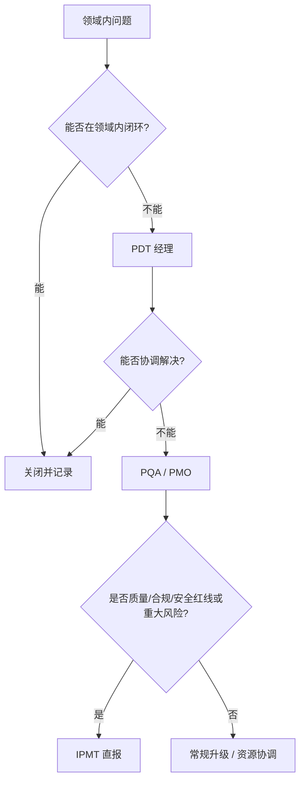

# IPD 角色与 RACI 矩阵

> R=负责执行，A=最终批准（每项仅一个 A），C=被咨询，I=被通知。项目可在此矩阵上做裁剪，但 A 必须唯一。

---

## 0. 一图看懂：问题怎么升级



> 原则：谁执行，谁不能单独验收自己；谁批准，谁对结果负责。

## 1. 角色定义

| 角色 | 定位 | 核心职责 | 关键产出 |
|---|---|---|---|
| **IPMT** | 投资决策层 | 组合排序、DCP 决策、预算/资源批准、重大升级 | DCP 纪要、投资决策、资源承诺 |
| **PDT / LPDT** | 项目经营主体 | 端到端对目标/进度/成本/质量/交付负责；组织 DCP/TR | 项目主计划、DCP/TR 材料、状态报告 |
| **PQA** | 流程质量保证 | 流程符合性、交付物完整性、裁剪审核、审计、质量门禁 | PQA 审计报告、裁剪意见、质量门禁报告 |
| **MKT** | 市场与客户 | 市场/客户需求、商业论证、定价、上市、客户验收 | 市场需求分析、商业论证、上市计划 |
| **R&D** | 研发交付 | 技术可行性、架构/详细设计、开发、集成、技术风险 | 架构/设计、代码、技术报告 |
| **TEST** | 验证 | 测试策略、用例、执行、缺陷、验证结论 | 测试计划/报告、缺陷台账 |
| **SCM** | 供应链 | 采购、供应商、交期、备货、交付风险 | 供应计划、BOM 成本、交付台账 |
| **MFG** | 制造 | 产能、工艺、试产、良率、爬坡 | 产能/工艺/试产报告 |
| **SVC** | 服务 | 服务设计、SLA、备件、培训、客户支持 | 服务计划、服务准备报告 |
| **FIN** | 财务 | 成本、预算、ROI、现金流、投资跟踪 | 成本估算、预算、ROI 报告 |
| **QA** | 质量 | 质量目标、标准、认证、8D、质量门禁 | 质量计划、认证报告、8D 报告 |
| **LEGAL** | 法务 | 合同、IP、合规、许可 | 合同、IP 评估、合规意见 |
| **SEC** | 信息安全/合规 | 数据分类、隐私、安全、出口管制 | 安全/隐私评估、合规声明 |
| **CM** | 配置管理 | 配置项、基线、版本、变更记录 | 配置库、基线记录 |
| **CCB** | 变更控制 | 变更评审、影响分析、批准/拒绝 | CCB 纪要、变更记录 |
| **PMO** | 体系与组合 | 流程、模板、度量、审计、项目组合 | 流程文件、组合报告、审计报告 |

---

## 2. 阶段级 RACI

| 活动 | IPMT | PDT/LPDT | PQA | MKT | R&D | TEST | SCM | MFG | SVC | FIN | QA | PMO |
|---|---|---|---|---|---|---|---|---|---|---|---|---|
| 机会点初筛 | I | R | C | R | C | I | I | I | I | C | I | A |
| 立项申请书 | I | A/R | C | R | C | I | C | I | C | C | C | C |
| 商业论证 | I | A | C | R | C | I | C | I | I | R | I | C |
| 初始需求 | I | A | C | R | C | C | I | I | C | I | C | I |
| 技术可行性 | I | A | C | C | R | C | C | C | C | C | C | I |
| CDCP | A | R | C | C | C | C | C | C | C | C | C | C |
| 项目主计划 | I | A/R | C | C | C | C | C | C | C | C | C | C |
| 需求基线 | I | A | C | C | R | C | I | I | C | I | C | I |
| 架构基线 | I | A | C | I | R | C | C | C | C | I | C | I |
| 质量/测试计划 | I | A | C | I | C | R | I | I | I | I | R | C |
| 成本预算 | A | R | C | C | C | I | C | C | C | R | I | C |
| 供应/制造计划 | I | A | C | I | C | I | R | R | I | C | C | I |
| 服务计划 | I | A | C | C | C | I | C | C | R | C | C | I |
| PDCP | A | R | C | C | C | C | C | C | C | C | C | C |
| TR1 | I | A | R | C | R | R | C | C | C | I | C | C |
| TR2 | I | A | R | I | R | C | C | C | C | I | C | C |
| TR3 | I | A | R | I | R | C | C | R | C | I | C | C |
| TR4 | I | A | R | I | R | R | C | C | C | I | C | C |
| TR5 | I | A | R | C | C | R | C | C | R | I | R | C |
| TR6 | I | A | R | R | C | C | R | R | R | C | R | C |
| ADCP | A | R | C | R | C | C | C | C | C | C | C | C |
| 发布后监控 | I | A | C | C | C | C | C | C | R | C | R | C |
| EOL 决策 | A | R | C | R | C | I | R | C | R | R | C | C |

---

## 3. 关键事项的单一责任人

| 事项 | 唯一 A | 说明 |
|---|---|---|
| 项目目标/范围/进度/成本/质量 | PDT 经理 | 对项目经营结果负责 |
| 商业论证/市场假设 | MKT 负责人 | 对市场/客户判断负责 |
| 技术方案/架构 | R&D 架构师 | 对技术可行性负责 |
| 测试结论 | TEST 负责人 | 对验证结果负责 |
| 质量门禁 | QA/PQA | 对质量红线负责 |
| 成本/预算 | FIN | 对财务口径负责 |
| 供应/交付 | SCM | 对供应风险负责 |
| 制造/良率 | MFG | 对量产能力负责 |
| 服务/SLA | SVC | 对客户支持负责 |
| 合规/隐私/安全 | LEGAL/SEC | 对红线负责 |
| 变更批准 | CCB | 对变更影响负责 |
| DCP 决策 | IPMT | 对投资决策负责 |

---

## 4. 升级路径

```text
领域内无法闭环
   ↓
PDT 经理（项目内协调）
   ↓
PQA / PMO（流程/资源/跨项目）
   ↓
IPMT（投资/重大资源/红线）
```

**直报情形**（可越级）：

- 质量/合规/安全红线；
- 重大客户投诉/召回/监管处罚；
- 供应链断裂/关键供应商破产；
- 项目目标/预算发生重大偏离；
- 关键里程碑连续错过；
- 团队重大冲突/核心人员流失。

> 越级上报必须同步直接上级，避免“只报高层、不报直属”。

---

## 5. 小项目角色合并建议

C 类项目可合并角色，但不得合并“执行”和“验收”：

| 原角色 | 可合并为 | 限制 |
|---|---|---|
| MKT + 产品经理 | 产品负责人 | 客户验收仍需独立人 |
| R&D + TEST | 技术负责人 | 测试结论需独立复核 |
| QA + PQA | 质量负责人 | 质量门禁需独立批准 |
| SCM + MFG | 交付负责人 | 供应/制造风险仍需分别评估 |
| PMO + PDT 经理 | 项目经理 | 审计/裁剪审核需上级/PMO 复核 |

> 原则：**谁执行，谁不能单独验收自己**；谁批准，谁对结果负责。
