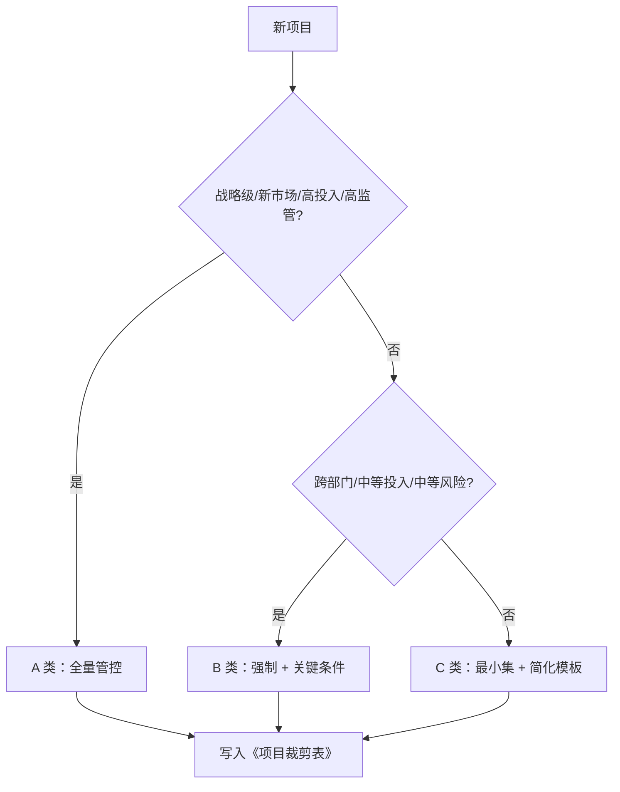

# 项目分级与裁剪指南

> 目的：让 A 类项目“管得住”，B 类项目“跑得顺”，C 类项目“不压垮”。分级不是降低标准，而是匹配管控强度。

---

## 0. 一图看懂



> 分级不是降低标准，而是匹配管控强度；红线项永远不能裁。

## 1. 项目分级标准

| 维度 | A 类（战略/复杂） | B 类（常规） | C 类（轻量） |
|---|---|---|---|
| 战略影响 | 公司级/新产品线/新市场 | 产品线级/现有市场扩展 | 小版本/改进/维护 |
| 投资规模 | 高（超过公司阈值） | 中 | 低 |
| 技术风险 | 高/新技术/新平台 | 中/成熟技术组合 | 低/沿用平台 |
| 合规/安全 | 高监管/红线多 | 一般 | 低 |
| 跨部门 | 多产品线/多地域/外部伙伴 | 单产品线多部门 | 单团队 |
| 周期 | 长（>12 个月） | 中（6~12 个月） | 短（<6 个月） |
| 客户影响 | 关键客户/大规模 | 部分客户 | 少量/内部 |
| 失败代价 | 高 | 中 | 低 |

> 分级由 PMO/产品线在立项时评定；项目范围/风险发生重大变化时重新评级。

---

## 2. 分级管控矩阵

| 管控项 | A 类 | B 类 | C 类 |
|---|---|---|---|
| DCP | CDCP/PDCP/ADCP/LDCP 全套，IPMT 全体 | CDCP/PDCP/ADCP，产品线 IPMT | 合并/授权决策，产品线负责人 |
| TR | TR1~TR6 全套 | TR1~TR6，部分可合并 | TR1/TR4/TR5 重点保留，TR2/TR3 可合并 |
| 模板 | 全量 | 强制 + 关键 C | 强制 + 简化 |
| 条件可选文件 | 原则上产出 | 按触发条件 | 原则上不产出，除非触发红线 |
| 非必要文件 | 按需 | 一般不产出 | 不产出 |
| PQA 审计 | 每阶段 | 关键节点 | 抽查 |
| 状态报告 | 周报 + 月度 | 双周/月度 | 月度/里程碑 |
| 变更审批 | CCB + IPMT（重大） | CCB | PDT 经理 + PQA（重大） |

---

## 3. C 类项目最小交付物集

C 类项目可以大幅简化，但以下“最小集”不能省：

| 阶段 | 最小交付物 | 说明 |
|---|---|---|
| 概念 | 简化立项申请书（含业务价值、质量目标、成本目标、初步风险） | 可合并商业论证 |
| 计划 | 简化项目计划（范围、进度、资源、预算、风险） | 可合并 WBS/甘特 |
| 开发 | SRS/需求清单、设计说明、测试记录、TR4 检查表 | TR2/TR3 可合并 |
| 验证 | 测试报告、缺陷清单、发布准入检查 | UAT 可简化 |
| 发布 | 发布说明、回退方案、发布检查表 | ADCP 可授权 |
| 生命周期 | 绩效/问题跟踪、复盘 | 可简化 |

**C 类也不得省略**：

- 质量目标与验收标准；
- 成本目标/预算；
- 初步风险识别与应对；
- 变更/问题/风险台账（可合并为一张表）；
- 发布回退方案；
- 归档。

---

## 4. 裁剪申请流程

```text
PDT 经理提出
   ↓
填写《项目裁剪表》（逐项：文件/适用性/理由/替代控制/风险）
   ↓
PQA 审核（红线、替代措施、审计风险）
   ↓
PDT 经理批准（A 类报 PMO/IPMT 备案）
   ↓
纳入项目基线；DCP/TR 时检查执行
```

### 4.1 裁剪表填写示例

| 交付物 | 适用性 | 理由 | 替代控制 | 风险 | PQA 意见 | 批准 |
|---|---|---|---|---|---|---|
| CP-T-02 商业论证 | 简化 | C 类内部工具，预算 < 20 万，无外部收入 | 在立项申请书中写清成本/收益/回收期 | 商业假设验证不足 | 同意，需财务会签 | PDT 经理 |
| CP-T-04 竞品分析 | 不适用 | 内部效率工具，无外部竞品 | 参考同类工具调研 1 页 | 方案可能落后 | 同意 | PDT 经理 |
| PL-T-09 采购与供应链计划 | 不适用 | 纯软件，无外购硬件 | 云资源按需采购，走 IT 采购流程 | 云成本波动 | 同意，需 IT 会签 | PDT 经理 |
| VA-T-07 UAT | 简化 | 内部用户，无合同验收 | 由产品负责人组织 5 名用户试用 | 用户覆盖不足 | 有条件同意，需扩大样本 | PDT 经理 |

---

## 5. 什么情况下必须“升级管控”

出现以下任一情况，项目应从 B/C 升级为 A/B，并补做相应交付物：

- 进入新市场/新客户/新监管领域；
- 关键技术未验证，存在路线失败风险；
- 投资额超过原预算 30%；
- 关键里程碑连续错过 2 次；
- 出现重大质量/合规/安全/供应链事件；
- 客户/合同要求提供完整 IPD 证据；
- 跨产品线/多地域协同显著增加。

---

## 6. 裁剪的审计与复盘

- PQA 每季度抽查裁剪表与实际情况是否一致；
- 审计重点：红线是否被裁、替代措施是否有效、风险是否闭环；
- 项目复盘时统计“裁剪导致的问题”，反哺分级标准；
- 连续出现裁剪失误的项目，提升管控级别。

> **一句话原则**：裁剪的是“文档工作量”，不是“责任和证据”。任何裁剪都要回答：**少了这份文件，我们靠什么保证质量、成本和风险可控？**
