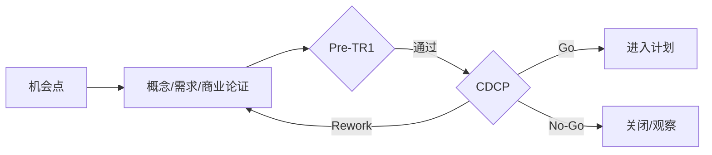

# 01. 概念阶段（CDCP）

> 把机会点转化为可立项的产品概念，回答“值不值得做、大致做什么”，通过 CDCP 获得计划阶段授权。

## 0. 一图看懂

## 1. 阶段门禁

- **门禁**：CDCP（商业决策）+ Pre-TR1（概念技术预审）
- **准入**：机会点初筛完成、战略/路标匹配、PDT 经理候选人指定、初步客户/市场证据、合规初筛无红线。
- **准出**：商业价值成立、目标客户/场景清晰、技术可行、风险可控、资源可承诺、合规无红线、立项申请书获批。

## 2. 重点抓什么

**本阶段重点**：商业论证与市场证据、初始需求与概念方案、技术可行性、初始风险/合规/IP/成本、PDT 组建与授权

| 必须抓住 | 容易漏掉 | 失败信号 |
|---|---|---|
| ✅ 商业价值成立 ✅ 目标客户/场景清晰 ✅ 技术可行 ✅ 风险可控 ✅ 资源可承诺 | ⚠️ 只有市场故事，没有客户证据 ⚠️ 成本/风险漏项 ⚠️ 合规/IP 红线未识别 | 🚨 CDCP 反复 Rework 🚨 关键假设没有验证计划 🚨 PDT 核心成员不到位 |

## 3. 本阶段物料

📄 模板 12 ｜ 📊 台账 6 ｜ ✅ 检查表 4 ｜ 🔄 SOP 3 ｜ 合计 25

| 编号 | 交付物 | 类型 | 等级 | 责任角色 | 用途 | 文件 |
|---|---|---|---|---|---|---|
| CP-T-01 | 项目立项申请书 | 📄 模板 | 🔴 M / 强制必选 | PDT经理（MKT/R&D/FIN/QA/PQA会签） | 回答“为什么做、做什么、做到什么程度、投入多少、风险是否可接受”，是 CDCP 核心输入和项目授权依据。 | [模板/CP-T-01-项目立项申请书.md](模板/CP-T-01-项目立项申请书.md) |
| CP-T-02 | 商业论证报告 | 📄 模板 | 🔴 M / 强制必选 | MKT/FIN | 论证市场空间、收入模型、成本结构、投资回报和关键假设，支撑 Go/No-Go。 | [模板/CP-T-02-商业论证报告.md](模板/CP-T-02-商业论证报告.md) |
| CP-T-03 | 市场需求与客户需求分析报告 | 📄 模板 | 🔴 M / 强制必选 | MKT/产品经理 | 把市场机会转化为可验证的客户需求，明确优先级和验收标准。 | [模板/CP-T-03-市场需求与客户需求分析报告.md](模板/CP-T-03-市场需求与客户需求分析报告.md) |
| CP-T-04 | 竞品分析报告 | 📄 模板 | 🟡 C / 条件可选 | MKT | 识别竞品格局、对标参数、差异化机会和定价参考。 | [模板/CP-T-04-竞品分析报告.md](模板/CP-T-04-竞品分析报告.md) |
| CP-T-05 | 初始需求规格说明书 | 📄 模板 | 🔴 M / 强制必选 | 产品经理/系统工程师 | 形成初始需求基线，作为概念方案、成本估算和 TR1 的输入。 | [模板/CP-T-05-初始需求规格说明书.md](模板/CP-T-05-初始需求规格说明书.md) |
| CP-T-06 | 产品概念方案 | 📄 模板 | 🔴 M / 强制必选 | 产品经理/架构师 | 描述产品形态、核心价值、技术路线、关键特性和目标成本。 | [模板/CP-T-06-产品概念方案.md](模板/CP-T-06-产品概念方案.md) |
| CP-T-07 | 技术可行性评估报告 | 📄 模板 | 🔴 M / 强制必选 | R&D/架构师 | 判断关键技术是否可行、成熟度如何、需要哪些验证。 | [模板/CP-T-07-技术可行性评估报告.md](模板/CP-T-07-技术可行性评估报告.md) |
| CP-T-08 | 初始风险与合规评估 | 📄 模板 | 🔴 M / 强制必选 | PQA/QA/LEGAL/SEC | 识别商业、技术、合规、隐私、安全、IP 红线，避免立项后“爆雷”。 | [模板/CP-T-08-初始风险与合规评估.md](模板/CP-T-08-初始风险与合规评估.md) |
| CP-T-09 | 初始成本与投资估算 | 📄 模板 | 🔴 M / 强制必选 | FIN/R&D/SCM | 给出研发、物料、制造、上市、服务成本和投资回收初算。 | [模板/CP-T-09-初始成本与投资估算.md](模板/CP-T-09-初始成本与投资估算.md) |
| CP-T-10 | PDT 任命书与项目组织 | 📄 模板 | 🔴 M / 强制必选 | 产品线负责人/IPMT | 明确 PDT 经理、核心成员、职责、授权、考核和汇报关系。 | [模板/CP-T-10-PDT-任命书与项目组织.md](模板/CP-T-10-PDT-任命书与项目组织.md) |
| CP-T-11 | 知识产权初评 | 📄 模板 | 🟡 C / 条件可选 | LEGAL/IP | 识别专利、商标、著作权、开源、FTO 风险，提出布局建议。 | [模板/CP-T-11-知识产权初评.md](模板/CP-T-11-知识产权初评.md) |
| CP-T-12 | CDCP 汇报材料 | 📄 模板 | 🔴 M / 强制必选 | PDT经理 | 用统一结构向 IPMT 呈现决策请求、证据、风险和待决项。 | [模板/CP-T-12-CDCP-汇报材料.md](模板/CP-T-12-CDCP-汇报材料.md) |
| CP-R-01 | 机会点台账 | 📊 台账 | 🟡 C / 条件可选 | MKT/产品经理 | 跟踪机会来源、客户、规模、优先级、状态和转化结论。 | [台账/CP-R-01-机会点台账.md](台账/CP-R-01-机会点台账.md) |
| CP-R-02 | 初始需求台账 | 📊 台账 | 🔴 M / 强制必选 | 产品经理/MKT | 记录原始需求、来源、优先级、验收标准和状态，向 SRS/RTM 传递。 | [台账/CP-R-02-初始需求台账.md](台账/CP-R-02-初始需求台账.md) |
| CP-R-03 | 风险登记册 | 📊 台账 | 🔴 M / 强制必选 | PDT经理/PQA | 识别商业/技术/合规/供应链/进度风险，评估概率影响并制定应对。 | [台账/CP-R-03-风险登记册.md](台账/CP-R-03-风险登记册.md) |
| CP-R-04 | 干系人登记册 | 📊 台账 | 🟡 C / 条件可选 | PDT经理 | 识别客户、供应商、监管、内部干系人及影响力/态度。 | [台账/CP-R-04-干系人登记册.md](台账/CP-R-04-干系人登记册.md) |
| CP-R-05 | 问题日志 | 📊 台账 | 🔴 M / 强制必选 | PDT经理 | 记录跨领域问题、责任人、期限和升级路径。 | [台账/CP-R-05-问题日志.md](台账/CP-R-05-问题日志.md) |
| CP-R-06 | 假设与依赖台账 | 📊 台账 | 🔴 M / 强制必选 | PDT经理 | 记录立项所依赖的关键假设和外部依赖，防止“假设变事实”。 | [台账/CP-R-06-假设与依赖台账.md](台账/CP-R-06-假设与依赖台账.md) |
| CP-C-01 | CDCP 决策检查表 | ✅ 检查表 | 🔴 M / 强制必选 | IPMT/PQA | 检查 CDCP 是否具备决策条件。 | [检查表/CP-C-01-CDCP-决策检查表.md](检查表/CP-C-01-CDCP-决策检查表.md) |
| CP-C-02 | 立项申请书完整性检查表 | ✅ 检查表 | 🔴 M / 强制必选 | PQA | 检查立项申请书是否覆盖必填模块。 | [检查表/CP-C-02-立项申请书完整性检查表.md](检查表/CP-C-02-立项申请书完整性检查表.md) |
| CP-C-03 | 需求质量检查表 | ✅ 检查表 | 🔴 M / 强制必选 | 产品/TEST | 检查初始需求是否完整、一致、可测试、可追溯。 | [检查表/CP-C-03-需求质量检查表.md](检查表/CP-C-03-需求质量检查表.md) |
| CP-C-04 | 合规与 IP 初筛检查表 | ✅ 检查表 | 🟡 C / 条件可选 | LEGAL/SEC | 检查法规、许可、隐私、安全、出口管制和 IP 红线。 | [检查表/CP-C-04-合规与-IP-初筛检查表.md](检查表/CP-C-04-合规与-IP-初筛检查表.md) |
| CP-S-01 | 机会点识别与立项 SOP | 🔄 SOP | 🔴 M / 强制必选 | 产品线/PMO | 规范从机会点到立项的全过程。 | [SOP/CP-S-01-机会点识别与立项-SOP.md](SOP/CP-S-01-机会点识别与立项-SOP.md) |
| CP-S-02 | 需求收集与分析 SOP | 🔄 SOP | 🔴 M / 强制必选 | MKT/产品经理 | 规范需求来源、访谈、整理、优先级和基线。 | [SOP/CP-S-02-需求收集与分析-SOP.md](SOP/CP-S-02-需求收集与分析-SOP.md) |
| CP-S-03 | 概念方案开发与验证 SOP | 🔄 SOP | 🟡 C / 条件可选 | 产品/R&D | 规范概念生成、备选评估、原型/仿真和概念选择。 | [SOP/CP-S-03-概念方案开发与验证-SOP.md](SOP/CP-S-03-概念方案开发与验证-SOP.md) |

## 4. 使用提示

- 先读 `00-总览与使用说明/IPD流程总览.md` 和 `DCP与TR时序.md`；
- 用 `08-公共模板与规范/模板/CM-T-18-项目裁剪表.md` 做裁剪；
- 每份模板的“核心必填”栏目不得整体省略；
- DCP/TR 前用对应 `检查表/` 自检，问题闭环后再上会。
