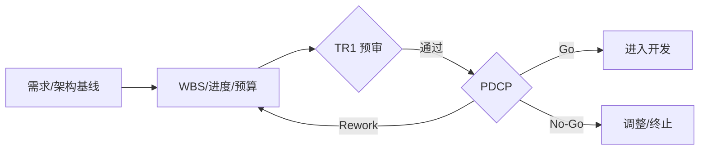

# 02. 计划阶段（PDCP）

> 把概念转化为可执行的项目计划，完成需求/架构基线和预算/资源承诺，通过 PDCP 签署项目任务书。

## 0. 一图看懂

## 1. 阶段门禁

- **门禁**：PDCP（商业决策）+ TR1 准入预审
- **准入**：CDCP Go、立项申请书/商业论证获批、PDT 核心团队到位、初始需求/概念方案基线、预算框架预沟通。
- **准出**：需求/架构基线冻结、计划闭合、预算/资源获批、供应/制造/服务可行、Top 风险有应对、任务书签署。

## 2. 重点抓什么

**本阶段重点**：需求基线与架构、WBS/进度/资源/预算、质量/测试计划、供应/制造/服务计划、变更/风险/配置机制

| 必须抓住 | 容易漏掉 | 失败信号 |
|---|---|---|
| ✅ 需求/架构冻结 ✅ 计划闭合 ✅ 预算/资源获批 ✅ 供应/制造/服务可行 ✅ Top 风险有应对 | ⚠️ WBS 漏项 ⚠️ 资源只写部门不写人 ⚠️ 关键路径没有缓冲 | 🚨 计划反复改基线 🚨 预算/资源缺口靠“后面再说” 🚨 供应/制造未介入 |

## 3. 本阶段物料

📄 模板 19 ｜ 📊 台账 8 ｜ ✅ 检查表 7 ｜ 🔄 SOP 4 ｜ 合计 38

| 编号 | 交付物 | 类型 | 等级 | 责任角色 | 用途 | 文件 |
|---|---|---|---|---|---|---|
| PL-T-01 | 项目主计划 | 📄 模板 | 🔴 M / 强制必选 | PDT经理 | 项目执行的总体纲领，整合范围、进度、成本、质量、资源和风险。 | [模板/PL-T-01-项目主计划.md](模板/PL-T-01-项目主计划.md) |
| PL-T-02 | WBS 工作分解结构 | 📄 模板 | 🔴 M / 强制必选 | PDT经理 | 把交付范围分解为可估算、可分配、可验收的工作包。 | [模板/PL-T-02-WBS-工作分解结构.md](模板/PL-T-02-WBS-工作分解结构.md) |
| PL-T-03 | 项目进度计划/甘特图 | 📄 模板 | 🔴 M / 强制必选 | PDT经理 | 明确活动、工期、依赖、关键路径和缓冲。 | [模板/PL-T-03-项目进度计划-甘特图.md](模板/PL-T-03-项目进度计划-甘特图.md) |
| PL-T-04 | 产品需求规格书 SRS（基线版） | 📄 模板 | 🔴 M / 强制必选 | 产品/系统工程师 | 形成受控需求基线，作为设计、开发、测试和验收依据。 | [模板/PL-T-04-产品需求规格书-SRS（基线版）.md](模板/PL-T-04-产品需求规格书-SRS（基线版）.md) |
| PL-T-05 | 系统架构设计说明书 | 📄 模板 | 🔴 M / 强制必选 | 架构师 | 定义系统架构、模块、接口、技术选型、部署和非功能设计。 | [模板/PL-T-05-系统架构设计说明书.md](模板/PL-T-05-系统架构设计说明书.md) |
| PL-T-06 | 质量保证计划 | 📄 模板 | 🔴 M / 强制必选 | PQA/QA | 明确质量目标、标准、评审、测试、度量、审计和缺陷门槛。 | [模板/PL-T-06-质量保证计划.md](模板/PL-T-06-质量保证计划.md) |
| PL-T-07 | 测试策略与测试计划 | 📄 模板 | 🔴 M / 强制必选 | TEST | 定义测试范围、层级、环境、数据、准入准出和资源。 | [模板/PL-T-07-测试策略与测试计划.md](模板/PL-T-07-测试策略与测试计划.md) |
| PL-T-08 | 成本预算与投资回报计划 | 📄 模板 | 🔴 M / 强制必选 | FIN/PDT | 形成项目预算、现金流、ROI 和成本控制机制。 | [模板/PL-T-08-成本预算与投资回报计划.md](模板/PL-T-08-成本预算与投资回报计划.md) |
| PL-T-09 | 采购与供应链计划 | 📄 模板 | 🟡 C / 条件可选 | SCM/PROC | 明确 BOM/服务清单、供应商、交期、备货、成本和风险。 | [模板/PL-T-09-采购与供应链计划.md](模板/PL-T-09-采购与供应链计划.md) |
| PL-T-10 | 制造与产能计划 | 📄 模板 | 🟡 C / 条件可选 | MFG | 明确产能、产线、工装、良率、爬坡和质量控制。 | [模板/PL-T-10-制造与产能计划.md](模板/PL-T-10-制造与产能计划.md) |
| PL-T-11 | 服务与支持计划 | 📄 模板 | 🔴 M / 强制必选 | SVC | 明确服务模式、SLA、备件、热线、培训和升级路径。 | [模板/PL-T-11-服务与支持计划.md](模板/PL-T-11-服务与支持计划.md) |
| PL-T-12 | 风险管理计划 | 📄 模板 | 🔴 M / 强制必选 | PQA/PDT | 定义风险策略、识别、评估、应对、监控和升级机制。 | [模板/PL-T-12-风险管理计划.md](模板/PL-T-12-风险管理计划.md) |
| PL-T-13 | 沟通与干系人管理计划 | 📄 模板 | 🟡 C / 条件可选 | PDT经理 | 明确干系人、沟通频率、渠道和升级方式。 | [模板/PL-T-13-沟通与干系人管理计划.md](模板/PL-T-13-沟通与干系人管理计划.md) |
| PL-T-14 | 配置与文档管理计划 | 📄 模板 | 🔴 M / 强制必选 | CM/PQA | 定义配置项、基线、版本、变更、权限和归档规则。 | [模板/PL-T-14-配置与文档管理计划.md](模板/PL-T-14-配置与文档管理计划.md) |
| PL-T-15 | 合规/信息安全/隐私计划 | 📄 模板 | 🟡 C / 条件可选 | SEC/LEGAL | 明确适用法规、数据分类、隐私、安全和审计要求。 | [模板/PL-T-15-合规-信息安全-隐私计划.md](模板/PL-T-15-合规-信息安全-隐私计划.md) |
| PL-T-16 | 知识产权计划 | 📄 模板 | 🟡 C / 条件可选 | LEGAL/IP | 明确 IP 目标、布局、申请、FTO 和保密措施。 | [模板/PL-T-16-知识产权计划.md](模板/PL-T-16-知识产权计划.md) |
| PL-T-17 | 项目任务书/内部合同 | 📄 模板 | 🔴 M / 强制必选 | IPMT/PDT | 明确项目目标、范围、交付、预算、资源、考核和退出机制。 | [模板/PL-T-17-项目任务书-内部合同.md](模板/PL-T-17-项目任务书-内部合同.md) |
| PL-T-18 | PDCP 汇报材料 | 📄 模板 | 🔴 M / 强制必选 | PDT经理 | 向 IPMT 呈现计划、预算、资源、风险和待决项。 | [模板/PL-T-18-PDCP-汇报材料.md](模板/PL-T-18-PDCP-汇报材料.md) |
| PL-T-19 | 试产/转产计划 | 📄 模板 | 🟡 C / 条件可选 | MFG/SCM | 明确试产批次、条件、物料、工艺、验收和转产标准。 | [模板/PL-T-19-试产-转产计划.md](模板/PL-T-19-试产-转产计划.md) |
| PL-R-01 | 需求跟踪矩阵 RTM | 📊 台账 | 🔴 M / 强制必选 | 产品/TEST | 需求到设计/开发/测试的双向追溯。 | [台账/PL-R-01-需求跟踪矩阵-RTM.md](台账/PL-R-01-需求跟踪矩阵-RTM.md) |
| PL-R-02 | 变更请求台账 | 📊 台账 | 🔴 M / 强制必选 | PDT经理/CCB | 记录 CR、影响分析、决策、实施和验证。 | [台账/PL-R-02-变更请求台账.md](台账/PL-R-02-变更请求台账.md) |
| PL-R-03 | 行动项台账 | 📊 台账 | 🔴 M / 强制必选 | PDT经理 | 会议/评审行动项闭环。 | [台账/PL-R-03-行动项台账.md](台账/PL-R-03-行动项台账.md) |
| PL-R-04 | 决策记录台账 | 📊 台账 | 🔴 M / 强制必选 | PDT经理/PQA | 记录决策、依据、责任人、日期和影响。 | [台账/PL-R-04-决策记录台账.md](台账/PL-R-04-决策记录台账.md) |
| PL-R-05 | 依赖台账 | 📊 台账 | 🔴 M / 强制必选 | PDT经理 | 内外部依赖、接口人、需要日期和状态。 | [台账/PL-R-05-依赖台账.md](台账/PL-R-05-依赖台账.md) |
| PL-R-06 | 风险登记册 | 📊 台账 | 🔴 M / 强制必选 | PQA/PDT | 滚动更新风险。 | [台账/PL-R-06-风险登记册.md](台账/PL-R-06-风险登记册.md) |
| PL-R-07 | 问题日志 | 📊 台账 | 🔴 M / 强制必选 | PDT经理 | 滚动更新问题。 | [台账/PL-R-07-问题日志.md](台账/PL-R-07-问题日志.md) |
| PL-R-08 | 资源与技能台账 | 📊 台账 | 🟡 C / 条件可选 | PDT经理/HR | 资源缺口、技能、到位计划。 | [台账/PL-R-08-资源与技能台账.md](台账/PL-R-08-资源与技能台账.md) |
| PL-C-01 | PDCP 决策检查表 | ✅ 检查表 | 🔴 M / 强制必选 | IPMT/PQA | 检查 PDCP 是否具备决策条件。 | [检查表/PL-C-01-PDCP-决策检查表.md](检查表/PL-C-01-PDCP-决策检查表.md) |
| PL-C-02 | 项目计划完整性检查表 | ✅ 检查表 | 🔴 M / 强制必选 | PQA | 检查项目计划是否覆盖范围、进度、成本、质量、资源和风险。 | [检查表/PL-C-02-项目计划完整性检查表.md](检查表/PL-C-02-项目计划完整性检查表.md) |
| PL-C-03 | 需求基线评审检查表 | ✅ 检查表 | 🔴 M / 强制必选 | 产品/TEST | 检查需求基线是否完整、一致、可测试、可追溯。 | [检查表/PL-C-03-需求基线评审检查表.md](检查表/PL-C-03-需求基线评审检查表.md) |
| PL-C-04 | 架构评审检查表 | ✅ 检查表 | 🔴 M / 强制必选 | 架构师/QA | 检查架构是否覆盖需求、接口闭合、非功能可验证。 | [检查表/PL-C-04-架构评审检查表.md](检查表/PL-C-04-架构评审检查表.md) |
| PL-C-05 | 预算与成本检查表 | ✅ 检查表 | 🔴 M / 强制必选 | FIN/PQA | 检查成本完整性、估算依据、预算匹配和 ROI。 | [检查表/PL-C-05-预算与成本检查表.md](检查表/PL-C-05-预算与成本检查表.md) |
| PL-C-06 | 质量/测试计划检查表 | ✅ 检查表 | 🔴 M / 强制必选 | QA/TEST/PQA | 检查质量目标和测试计划是否可执行、可验证。 | [检查表/PL-C-06-质量-测试计划检查表.md](检查表/PL-C-06-质量-测试计划检查表.md) |
| PL-C-07 | 供应链/制造就绪检查表 | ✅ 检查表 | 🟡 C / 条件可选 | SCM/MFG | 检查供应商、交期、备货、替代和制造准备。 | [检查表/PL-C-07-供应链-制造就绪检查表.md](检查表/PL-C-07-供应链-制造就绪检查表.md) |
| PL-S-01 | 项目计划编制 SOP | 🔄 SOP | 🔴 M / 强制必选 | PDT经理/PMO | 规范从范围到计划基线的编制过程。 | [SOP/PL-S-01-项目计划编制-SOP.md](SOP/PL-S-01-项目计划编制-SOP.md) |
| PL-S-02 | 需求基线与 RTM 管理 SOP | 🔄 SOP | 🔴 M / 强制必选 | 产品/系统工程师 | 规范需求基线建立、RTM 维护和变更追溯。 | [SOP/PL-S-02-需求基线与-RTM-管理-SOP.md](SOP/PL-S-02-需求基线与-RTM-管理-SOP.md) |
| PL-S-03 | 成本估算与预算 SOP | 🔄 SOP | 🔴 M / 强制必选 | FIN/PDT | 规范成本项识别、估算、预算、跟踪和偏差处理。 | [SOP/PL-S-03-成本估算与预算-SOP.md](SOP/PL-S-03-成本估算与预算-SOP.md) |
| PL-S-04 | 采购与供应商定点 SOP | 🔄 SOP | 🟡 C / 条件可选 | PROC/SCM | 规范寻源、评估、定点、合同、交付和绩效。 | [SOP/PL-S-04-采购与供应商定点-SOP.md](SOP/PL-S-04-采购与供应商定点-SOP.md) |

## 4. 使用提示

- 先读 `00-总览与使用说明/IPD流程总览.md` 和 `DCP与TR时序.md`；
- 用 `08-公共模板与规范/模板/CM-T-18-项目裁剪表.md` 做裁剪；
- 每份模板的“核心必填”栏目不得整体省略；
- DCP/TR 前用对应 `检查表/` 自检，问题闭环后再上会。
