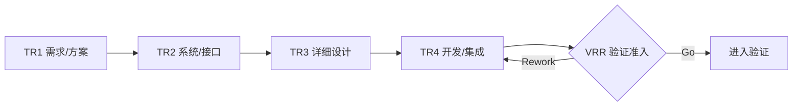

# 03. 开发阶段（TR1~TR4）

> 按基线完成系统/详细设计、开发、集成，通过 TR1~TR4 逐级确认技术成熟度，形成可验证版本/样机。

## 0. 一图看懂

## 1. 阶段门禁

- **门禁**：TR1~TR4（技术评审）+ VRR（验证准入，管理决策）
- **准入**：PDCP Go、需求/架构基线冻结、开发环境/工具链就绪、开发资源到位、变更/配置管理生效。
- **准出**：设计完成、集成通过、阻断缺陷清零、版本/文档受控、验证资源就绪。

## 2. 重点抓什么

**本阶段重点**：系统/详细设计、接口与集成、DFMEA/DFM/DFT/DFS、单元/集成测试、样机/BOM/工艺、设计变更与缺陷闭环

| 必须抓住 | 容易漏掉 | 失败信号 |
|---|---|---|
| ✅ 需求可追溯 ✅ 接口闭合 ✅ 设计可制造/可测试 ✅ 阻断缺陷清零 ✅ 版本受控 | ⚠️ 接口只写“待定” ⚠️ DFM/DFT/DFS 后置 ⚠️ 变更不走 CCB | 🚨 TR 开成汇报会 🚨 缺陷越修越多 🚨 样机问题重复出现 |

## 3. 本阶段物料

📄 模板 23 ｜ 📊 台账 10 ｜ ✅ 检查表 12 ｜ 🔄 SOP 6 ｜ 合计 51

| 编号 | 交付物 | 类型 | 等级 | 责任角色 | 用途 | 文件 |
|---|---|---|---|---|---|---|
| DV-T-01 | 系统需求规格书 | 📄 模板 | 🔴 M / 强制必选 | 系统工程师 | 把产品需求分解为系统级需求、接口和约束。 | [模板/DV-T-01-系统需求规格书.md](模板/DV-T-01-系统需求规格书.md) |
| DV-T-02 | 系统设计说明书 | 📄 模板 | 🔴 M / 强制必选 | 架构师 | 定义系统架构、子系统、接口、部署和非功能实现。 | [模板/DV-T-02-系统设计说明书.md](模板/DV-T-02-系统设计说明书.md) |
| DV-T-03 | 接口设计规格书 | 📄 模板 | 🔴 M / 强制必选 | 架构/R&D | 定义接口协议、数据、错误码、版本和安全要求。 | [模板/DV-T-03-接口设计规格书.md](模板/DV-T-03-接口设计规格书.md) |
| DV-T-04 | 详细设计说明书 | 📄 模板 | 🔴 M / 强制必选 | R&D | 指导编码/实现的模块级设计。 | [模板/DV-T-04-详细设计说明书.md](模板/DV-T-04-详细设计说明书.md) |
| DV-T-05 | 数据库设计说明书 | 📄 模板 | 🟡 C / 条件可选 | R&D | 定义表、字段、索引、事务、迁移和安全。 | [模板/DV-T-05-数据库设计说明书.md](模板/DV-T-05-数据库设计说明书.md) |
| DV-T-06 | 硬件设计文件 | 📄 模板 | 🟡 C / 条件可选 | 硬件 R&D | 原理图、PCB、器件、电源、EMC、热和可靠性设计。 | [模板/DV-T-06-硬件设计文件.md](模板/DV-T-06-硬件设计文件.md) |
| DV-T-07 | 结构/工艺设计文件 | 📄 模板 | 🟡 C / 条件可选 | 结构/工艺 | 3D/2D、公差、材料、工艺路线和检验要求。 | [模板/DV-T-07-结构-工艺设计文件.md](模板/DV-T-07-结构-工艺设计文件.md) |
| DV-T-08 | DFMEA/PFMEA | 📄 模板 | 🟡 C / 条件可选 | QA/R&D/MFG | 识别失效模式、后果、原因、探测和预防措施。 | [模板/DV-T-08-DFMEA-PFMEA.md](模板/DV-T-08-DFMEA-PFMEA.md) |
| DV-T-09 | 技术选型与 ADR | 📄 模板 | 🟡 C / 条件可选 | 架构师 | 记录技术选择背景、选项、依据和后果。 | [模板/DV-T-09-技术选型与-ADR.md](模板/DV-T-09-技术选型与-ADR.md) |
| DV-T-10 | 原型/仿真验证报告 | 📄 模板 | 🟡 C / 条件可选 | R&D | 记录原型/仿真目的、模型、结果和结论。 | [模板/DV-T-10-原型-仿真验证报告.md](模板/DV-T-10-原型-仿真验证报告.md) |
| DV-T-11 | 单元测试计划与报告 | 📄 模板 | 🔴 M / 强制必选 | R&D | 验证模块级正确性、覆盖率和缺陷。 | [模板/DV-T-11-单元测试计划与报告.md](模板/DV-T-11-单元测试计划与报告.md) |
| DV-T-12 | 集成测试计划与报告 | 📄 模板 | 🔴 M / 强制必选 | TEST/R&D | 验证模块/子系统集成后的接口和功能。 | [模板/DV-T-12-集成测试计划与报告.md](模板/DV-T-12-集成测试计划与报告.md) |
| DV-T-13 | 代码评审记录 | 📄 模板 | 🟡 C / 条件可选 | R&D | 记录代码评审对象、问题、整改和结论。 | [模板/DV-T-13-代码评审记录.md](模板/DV-T-13-代码评审记录.md) |
| DV-T-14 | BOM 物料清单 | 📄 模板 | 🟡 C / 条件可选 | R&D/SCM | 定义产品物料层级、料号、数量、替代和成本。 | [模板/DV-T-14-BOM-物料清单.md](模板/DV-T-14-BOM-物料清单.md) |
| DV-T-15 | 工艺文件/作业指导书 | 📄 模板 | 🟡 C / 条件可选 | 工艺/MFG | 指导生产操作、参数、检验和安全。 | [模板/DV-T-15-工艺文件-作业指导书.md](模板/DV-T-15-工艺文件-作业指导书.md) |
| DV-T-16 | 样机试制报告 | 📄 模板 | 🟡 C / 条件可选 | R&D/MFG | 记录样机批次、问题、良率和结论。 | [模板/DV-T-16-样机试制报告.md](模板/DV-T-16-样机试制报告.md) |
| DV-T-17 | 软件版本发布说明 | 📄 模板 | 🔴 M / 强制必选 | R&D/发布 | 说明版本内容、变更、已知问题、升级和回退。 | [模板/DV-T-17-软件版本发布说明.md](模板/DV-T-17-软件版本发布说明.md) |
| DV-T-18 | 认证计划 | 📄 模板 | 🟡 C / 条件可选 | QA/SEC | 规划认证标准、机构、样品、周期和风险。 | [模板/DV-T-18-认证计划.md](模板/DV-T-18-认证计划.md) |
| DV-T-19 | 知识产权申请材料 | 📄 模板 | 🟡 C / 条件可选 | LEGAL/IP | 准备交底书、检索、权利要求和申请。 | [模板/DV-T-19-知识产权申请材料.md](模板/DV-T-19-知识产权申请材料.md) |
| DV-T-20 | TR1~TR4 评审材料 | 📄 模板 | 🔴 M / 强制必选 | PDT/各领域 | 每个 TR 一套：目标、范围、输入、证据、问题、结论、待办。 | [模板/DV-T-20-TR1~TR4-评审材料.md](模板/DV-T-20-TR1~TR4-评审材料.md) |
| DV-T-21 | 技术风险与问题闭环报告 | 📄 模板 | 🔴 M / 强制必选 | PQA/PDT | 汇总 Top 技术风险/问题、措施、责任人和剩余风险。 | [模板/DV-T-21-技术风险与问题闭环报告.md](模板/DV-T-21-技术风险与问题闭环报告.md) |
| DV-T-22 | 可制造性/可测试性/可服务性评估 | 📄 模板 | 🟡 C / 条件可选 | MFG/TEST/SVC | 从制造、测试、服务角度提出设计改进。 | [模板/DV-T-22-可制造性-可测试性-可服务性评估.md](模板/DV-T-22-可制造性-可测试性-可服务性评估.md) |
| DV-T-23 | 开发阶段周报/月报 | 📄 模板 | 🟡 C / 条件可选 | PDT经理 | 汇报进度、偏差、风险、问题和求助。 | [模板/DV-T-23-开发阶段周报-月报.md](模板/DV-T-23-开发阶段周报-月报.md) |
| DV-R-01 | 需求跟踪矩阵 RTM | 📊 台账 | 🔴 M / 强制必选 | 产品/TEST | 滚动维护需求到设计/开发/测试的追溯。 | [台账/DV-R-01-需求跟踪矩阵-RTM.md](台账/DV-R-01-需求跟踪矩阵-RTM.md) |
| DV-R-02 | 设计变更台账 | 📊 台账 | 🔴 M / 强制必选 | CM/CCB | 记录设计变更申请、影响、决策、实施和验证。 | [台账/DV-R-02-设计变更台账.md](台账/DV-R-02-设计变更台账.md) |
| DV-R-03 | 缺陷台账 | 📊 台账 | 🔴 M / 强制必选 | TEST/R&D | 缺陷全生命周期。 | [台账/DV-R-03-缺陷台账.md](台账/DV-R-03-缺陷台账.md) |
| DV-R-04 | 风险登记册 | 📊 台账 | 🔴 M / 强制必选 | PQA/PDT | 滚动更新风险。 | [台账/DV-R-04-风险登记册.md](台账/DV-R-04-风险登记册.md) |
| DV-R-05 | 问题日志 | 📊 台账 | 🔴 M / 强制必选 | PDT经理 | 滚动更新问题。 | [台账/DV-R-05-问题日志.md](台账/DV-R-05-问题日志.md) |
| DV-R-06 | 技术债台账 | 📊 台账 | 🟡 C / 条件可选 | 架构/R&D | 识别技术债、影响和偿还计划。 | [台账/DV-R-06-技术债台账.md](台账/DV-R-06-技术债台账.md) |
| DV-R-07 | BOM/物料台账 | 📊 台账 | 🟡 C / 条件可选 | R&D/SCM | 物料层级、料号、数量、替代、成本和供应状态。 | [台账/DV-R-07-BOM-物料台账.md](台账/DV-R-07-BOM-物料台账.md) |
| DV-R-08 | 供应商交付台账 | 📊 台账 | 🟡 C / 条件可选 | PROC/SCM | 订单、交期、到货、检验、异常和绩效。 | [台账/DV-R-08-供应商交付台账.md](台账/DV-R-08-供应商交付台账.md) |
| DV-R-09 | 认证台账 | 📊 台账 | 🟡 C / 条件可选 | QA/SEC | 标准、机构、样品、进度、证书和不符合项。 | [台账/DV-R-09-认证台账.md](台账/DV-R-09-认证台账.md) |
| DV-R-10 | 样机台账 | 📊 台账 | 🟡 C / 条件可选 | R&D/MFG | 样机编号、批次、用途、状态、问题和去向。 | [台账/DV-R-10-样机台账.md](台账/DV-R-10-样机台账.md) |
| DV-C-01 | TR1 检查表 | ✅ 检查表 | 🔴 M / 强制必选 | PQA/各领域 | 检查需求与方案基线是否具备进入开发条件。 | [检查表/DV-C-01-TR1-检查表.md](检查表/DV-C-01-TR1-检查表.md) |
| DV-C-02 | TR2 检查表 | ✅ 检查表 | 🔴 M / 强制必选 | PQA/架构 | 检查系统设计与接口是否闭合、可验证。 | [检查表/DV-C-02-TR2-检查表.md](检查表/DV-C-02-TR2-检查表.md) |
| DV-C-03 | TR3 检查表 | ✅ 检查表 | 🔴 M / 强制必选 | PQA/R&D | 检查详细设计是否可编码、可制造、可测试。 | [检查表/DV-C-03-TR3-检查表.md](检查表/DV-C-03-TR3-检查表.md) |
| DV-C-04 | TR4 检查表 | ✅ 检查表 | 🔴 M / 强制必选 | PQA/TEST | 检查开发完成与集成是否具备验证准入条件。 | [检查表/DV-C-04-TR4-检查表.md](检查表/DV-C-04-TR4-检查表.md) |
| DV-C-05 | 需求可测试性检查表 | ✅ 检查表 | 🔴 M / 强制必选 | TEST/产品 | 检查每条需求是否可测试、可判定。 | [检查表/DV-C-05-需求可测试性检查表.md](检查表/DV-C-05-需求可测试性检查表.md) |
| DV-C-06 | 架构质量属性检查表 | ✅ 检查表 | 🟡 C / 条件可选 | 架构/QA | 检查性能、可靠性、安全、可维护、可扩展、可部署。 | [检查表/DV-C-06-架构质量属性检查表.md](检查表/DV-C-06-架构质量属性检查表.md) |
| DV-C-07 | 代码评审检查表 | ✅ 检查表 | 🟡 C / 条件可选 | R&D | 检查代码正确性、边界、异常、安全和可读性。 | [检查表/DV-C-07-代码评审检查表.md](检查表/DV-C-07-代码评审检查表.md) |
| DV-C-08 | DFM 检查表 | ✅ 检查表 | 🟡 C / 条件可选 | MFG/R&D | 检查物料、工艺、公差、装配、测试和成本。 | [检查表/DV-C-08-DFM-检查表.md](检查表/DV-C-08-DFM-检查表.md) |
| DV-C-09 | DFT 检查表 | ✅ 检查表 | 🟡 C / 条件可选 | TEST/R&D | 检查测试点、夹具、诊断、覆盖率和时间。 | [检查表/DV-C-09-DFT-检查表.md](检查表/DV-C-09-DFT-检查表.md) |
| DV-C-10 | DFS 检查表 | ✅ 检查表 | 🟡 C / 条件可选 | SVC/R&D | 检查可诊断、可维修、备件、培训和安全。 | [检查表/DV-C-10-DFS-检查表.md](检查表/DV-C-10-DFS-检查表.md) |
| DV-C-11 | 信息安全/隐私设计检查表 | ✅ 检查表 | 🟡 C / 条件可选 | SEC/架构 | 检查数据分类、最小权限、加密、审计、隐私和漏洞。 | [检查表/DV-C-11-信息安全-隐私设计检查表.md](检查表/DV-C-11-信息安全-隐私设计检查表.md) |
| DV-C-12 | 变更影响分析检查表 | ✅ 检查表 | 🔴 M / 强制必选 | CCB/PQA | 检查变更是否分析了范围、进度、成本、质量、风险、接口和验证。 | [检查表/DV-C-12-变更影响分析检查表.md](检查表/DV-C-12-变更影响分析检查表.md) |
| DV-S-01 | TR 技术评审运作 SOP | 🔄 SOP | 🔴 M / 强制必选 | PQA/PMO | 规范 TR1~TR4 的申请、预审、评审、闭环和结论。 | [SOP/DV-S-01-TR-技术评审运作-SOP.md](SOP/DV-S-01-TR-技术评审运作-SOP.md) |
| DV-S-02 | 设计变更管理 SOP | 🔄 SOP | 🔴 M / 强制必选 | CCB/CM | 规范设计变更的申请、影响分析、决策、实施和验证。 | [SOP/DV-S-02-设计变更管理-SOP.md](SOP/DV-S-02-设计变更管理-SOP.md) |
| DV-S-03 | 配置管理 SOP | 🔄 SOP | 🔴 M / 强制必选 | CM/PMO | 规范配置项、版本、基线、变更和审计。 | [SOP/DV-S-03-配置管理-SOP.md](SOP/DV-S-03-配置管理-SOP.md) |
| DV-S-04 | 缺陷管理 SOP | 🔄 SOP | 🔴 M / 强制必选 | TEST/R&D | 规范缺陷提交、分级、修复、验证和关闭。 | [SOP/DV-S-04-缺陷管理-SOP.md](SOP/DV-S-04-缺陷管理-SOP.md) |
| DV-S-05 | 样机试制 SOP | 🔄 SOP | 🟡 C / 条件可选 | R&D/MFG | 规范样机备料、试制、检验、问题闭环和报告。 | [SOP/DV-S-05-样机试制-SOP.md](SOP/DV-S-05-样机试制-SOP.md) |
| DV-S-06 | 供应商交付管理 SOP | 🔄 SOP | 🟡 C / 条件可选 | PROC/SCM | 规范订单、跟催、来料检验、问题和绩效。 | [SOP/DV-S-06-供应商交付管理-SOP.md](SOP/DV-S-06-供应商交付管理-SOP.md) |

## 4. 使用提示

- 先读 `00-总览与使用说明/IPD流程总览.md` 和 `DCP与TR时序.md`；
- 用 `08-公共模板与规范/模板/CM-T-18-项目裁剪表.md` 做裁剪；
- 每份模板的“核心必填”栏目不得整体省略；
- DCP/TR 前用对应 `检查表/` 自检，问题闭环后再上会。
