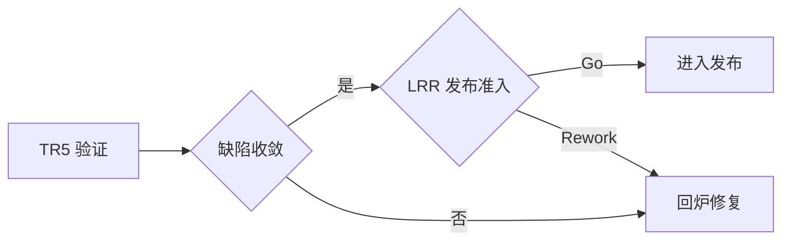

# 04. 验证阶段（TR5）

> 验证产品满足需求、质量、可靠性、安全、合规要求，缺陷收敛到发布门槛，通过 TR5 进入发布准备。

## 0. 一图看懂

## 1. 阶段门禁

- **门禁**：TR5（技术评审）+ LRR（发布准入预审）
- **准入**：TR4 通过、候选版本/样机冻结、测试环境/数据就绪、认证/试产条件就绪、缺陷门槛定义。
- **准出**：测试覆盖达标、阻断/严重缺陷清零、性能/可靠性/安全/合规通过、试产良率达标、服务/文档/培训就绪、剩余风险接受。

## 2. 重点抓什么

**本阶段重点**：系统/性能/可靠性/安全测试、UAT/Beta/试点、认证/安规/EMC、试产/小批量、缺陷收敛与质量度量、服务/文档验证

| 必须抓住 | 容易漏掉 | 失败信号 |
|---|---|---|
| ✅ 测试覆盖达标 ✅ 阻断/严重缺陷清零 ✅ 认证/合规通过 ✅ 试产良率达标 ✅ 服务/文档就绪 | ⚠️ 只测正常路径 ⚠️ 认证样品/周期没预留 ⚠️ 遗留缺陷没有接受人 | 🚨 TR5 前还在改需求 🚨 缺陷关闭率突然“变好” 🚨 试产问题没有根因 |

## 3. 本阶段物料

📄 模板 14 ｜ 📊 台账 7 ｜ ✅ 检查表 7 ｜ 🔄 SOP 5 ｜ 合计 33

| 编号 | 交付物 | 类型 | 等级 | 责任角色 | 用途 | 文件 |
|---|---|---|---|---|---|---|
| VA-T-01 | 验证测试计划 | 📄 模板 | 🔴 M / 强制必选 | TEST | 定义验证范围、策略、环境、数据、进度和准入准出。 | [模板/VA-T-01-验证测试计划.md](模板/VA-T-01-验证测试计划.md) |
| VA-T-02 | 系统测试报告 | 📄 模板 | 🔴 M / 强制必选 | TEST | 汇总测试执行、缺陷、覆盖率和结论。 | [模板/VA-T-02-系统测试报告.md](模板/VA-T-02-系统测试报告.md) |
| VA-T-03 | 性能/压力测试报告 | 📄 模板 | 🟡 C / 条件可选 | TEST | 验证性能指标、瓶颈和调优效果。 | [模板/VA-T-03-性能-压力测试报告.md](模板/VA-T-03-性能-压力测试报告.md) |
| VA-T-04 | 可靠性/环境测试报告 | 📄 模板 | 🟡 C / 条件可选 | TEST/QA | 验证可靠性、环境适应性和失效模式。 | [模板/VA-T-04-可靠性-环境测试报告.md](模板/VA-T-04-可靠性-环境测试报告.md) |
| VA-T-05 | 安全/渗透测试报告 | 📄 模板 | 🟡 C / 条件可选 | SEC | 识别安全漏洞、风险和修复建议。 | [模板/VA-T-05-安全-渗透测试报告.md](模板/VA-T-05-安全-渗透测试报告.md) |
| VA-T-06 | 安规/EMC/认证报告 | 📄 模板 | 🟡 C / 条件可选 | QA/SEC | 证明产品符合安规、EMC、认证要求。 | [模板/VA-T-06-安规-EMC-认证报告.md](模板/VA-T-06-安规-EMC-认证报告.md) |
| VA-T-07 | 用户验收测试 UAT 报告 | 📄 模板 | 🔴 M / 强制必选 | MKT/TEST/客户 | 证明产品满足客户验收标准。 | [模板/VA-T-07-用户验收测试-UAT-报告.md](模板/VA-T-07-用户验收测试-UAT-报告.md) |
| VA-T-08 | Beta/试点报告 | 📄 模板 | 🟡 C / 条件可选 | MKT/产品 | 验证真实用户场景、反馈和问题。 | [模板/VA-T-08-Beta-试点报告.md](模板/VA-T-08-Beta-试点报告.md) |
| VA-T-09 | 缺陷收敛与质量度量报告 | 📄 模板 | 🔴 M / 强制必选 | QA/PQA | 证明缺陷趋势收敛、质量达标、遗留风险可控。 | [模板/VA-T-09-缺陷收敛与质量度量报告.md](模板/VA-T-09-缺陷收敛与质量度量报告.md) |
| VA-T-10 | 试产/小批量验证报告 | 📄 模板 | 🟡 C / 条件可选 | MFG/QA | 验证批量制造能力、良率和问题。 | [模板/VA-T-10-试产-小批量验证报告.md](模板/VA-T-10-试产-小批量验证报告.md) |
| VA-T-11 | 服务准备验证报告 | 📄 模板 | 🔴 M / 强制必选 | SVC | 验证备件、工具、SLA、培训和升级路径。 | [模板/VA-T-11-服务准备验证报告.md](模板/VA-T-11-服务准备验证报告.md) |
| VA-T-12 | TR5 评审材料 | 📄 模板 | 🔴 M / 强制必选 | PDT | 汇总验证结果、缺陷、风险和准入建议。 | [模板/VA-T-12-TR5-评审材料.md](模板/VA-T-12-TR5-评审材料.md) |
| VA-T-13 | 发布准入评估报告 | 📄 模板 | 🔴 M / 强制必选 | PDT/PQA | 评估各领域就绪度、红线和发布建议。 | [模板/VA-T-13-发布准入评估报告.md](模板/VA-T-13-发布准入评估报告.md) |
| VA-T-14 | 剩余风险接受记录 | 📄 模板 | 🔴 M / 强制必选 | PDT/IPMT | 明确剩余风险、影响、缓解和接受人。 | [模板/VA-T-14-剩余风险接受记录.md](模板/VA-T-14-剩余风险接受记录.md) |
| VA-R-01 | 测试用例台账 | 📊 台账 | 🔴 M / 强制必选 | TEST | 用例、需求追溯、执行状态和结果。 | [台账/VA-R-01-测试用例台账.md](台账/VA-R-01-测试用例台账.md) |
| VA-R-02 | 缺陷台账 | 📊 台账 | 🔴 M / 强制必选 | TEST/R&D | 滚动维护缺陷。 | [台账/VA-R-02-缺陷台账.md](台账/VA-R-02-缺陷台账.md) |
| VA-R-03 | 认证台账 | 📊 台账 | 🟡 C / 条件可选 | QA/SEC | 标准、机构、样品、进度、证书和不符合项。 | [台账/VA-R-03-认证台账.md](台账/VA-R-03-认证台账.md) |
| VA-R-04 | 试产问题台账 | 📊 台账 | 🟡 C / 条件可选 | MFG/QA | 问题、原因、措施、验证和状态。 | [台账/VA-R-04-试产问题台账.md](台账/VA-R-04-试产问题台账.md) |
| VA-R-05 | 风险登记册 | 📊 台账 | 🔴 M / 强制必选 | PQA/PDT | 滚动更新风险。 | [台账/VA-R-05-风险登记册.md](台账/VA-R-05-风险登记册.md) |
| VA-R-06 | 问题日志 | 📊 台账 | 🔴 M / 强制必选 | PDT经理 | 滚动更新问题。 | [台账/VA-R-06-问题日志.md](台账/VA-R-06-问题日志.md) |
| VA-R-07 | 版本台账 | 📊 台账 | 🔴 M / 强制必选 | CM/发布 | 版本、内容、状态和发布记录。 | [台账/VA-R-07-版本台账.md](台账/VA-R-07-版本台账.md) |
| VA-C-01 | TR5 检查表 | ✅ 检查表 | 🔴 M / 强制必选 | PQA/各领域 | 检查验证是否完成、是否具备发布准入条件。 | [检查表/VA-C-01-TR5-检查表.md](检查表/VA-C-01-TR5-检查表.md) |
| VA-C-02 | 测试就绪检查表 | ✅ 检查表 | 🔴 M / 强制必选 | TEST | 检查版本、环境、数据、用例、人员和准入条件。 | [检查表/VA-C-02-测试就绪检查表.md](检查表/VA-C-02-测试就绪检查表.md) |
| VA-C-03 | 测试覆盖度检查表 | ✅ 检查表 | 🔴 M / 强制必选 | TEST/QA | 检查需求、场景、边界、异常、接口和非功能覆盖。 | [检查表/VA-C-03-测试覆盖度检查表.md](检查表/VA-C-03-测试覆盖度检查表.md) |
| VA-C-04 | 缺陷关闭标准检查表 | ✅ 检查表 | 🔴 M / 强制必选 | QA/TEST | 检查阻断/严重缺陷是否清零、遗留缺陷是否可接受。 | [检查表/VA-C-04-缺陷关闭标准检查表.md](检查表/VA-C-04-缺陷关闭标准检查表.md) |
| VA-C-05 | 认证合规检查表 | ✅ 检查表 | 🟡 C / 条件可选 | QA/SEC | 检查标准、样品、测试、证书和不符合项。 | [检查表/VA-C-05-认证合规检查表.md](检查表/VA-C-05-认证合规检查表.md) |
| VA-C-06 | 试产准入/准出检查表 | ✅ 检查表 | 🟡 C / 条件可选 | MFG/QA | 检查物料、工艺、设备、良率、问题和转产条件。 | [检查表/VA-C-06-试产准入-准出检查表.md](检查表/VA-C-06-试产准入-准出检查表.md) |
| VA-C-07 | 发布准入预检查表 | ✅ 检查表 | 🔴 M / 强制必选 | PQA/PDT | 检查质量、供应、制造、服务、市场和合规是否就绪。 | [检查表/VA-C-07-发布准入预检查表.md](检查表/VA-C-07-发布准入预检查表.md) |
| VA-S-01 | 测试管理 SOP | 🔄 SOP | 🔴 M / 强制必选 | TEST/QA | 规范测试计划、设计、执行、缺陷、报告和准入。 | [SOP/VA-S-01-测试管理-SOP.md](SOP/VA-S-01-测试管理-SOP.md) |
| VA-S-02 | 缺陷闭环 SOP | 🔄 SOP | 🔴 M / 强制必选 | QA/TEST | 规范缺陷提交、分级、修复、验证、关闭和遗留审批。 | [SOP/VA-S-02-缺陷闭环-SOP.md](SOP/VA-S-02-缺陷闭环-SOP.md) |
| VA-S-03 | 认证管理 SOP | 🔄 SOP | 🟡 C / 条件可选 | QA/SEC | 规范认证识别、计划、送检、整改、取证和维护。 | [SOP/VA-S-03-认证管理-SOP.md](SOP/VA-S-03-认证管理-SOP.md) |
| VA-S-04 | 试产管理 SOP | 🔄 SOP | 🟡 C / 条件可选 | MFG/QA | 规范试产准备、执行、检验、问题闭环和转产评审。 | [SOP/VA-S-04-试产管理-SOP.md](SOP/VA-S-04-试产管理-SOP.md) |
| VA-S-05 | 质量问题 8D 处理 SOP | 🔄 SOP | 🔴 M / 强制必选 | QA/SCM | 规范重大/重复/客户投诉问题的 8D 闭环。 | [SOP/VA-S-05-质量问题-8D-处理-SOP.md](SOP/VA-S-05-质量问题-8D-处理-SOP.md) |

## 4. 使用提示

- 先读 `00-总览与使用说明/IPD流程总览.md` 和 `DCP与TR时序.md`；
- 用 `08-公共模板与规范/模板/CM-T-18-项目裁剪表.md` 做裁剪；
- 每份模板的“核心必填”栏目不得整体省略；
- DCP/TR 前用对应 `检查表/` 自检，问题闭环后再上会。
