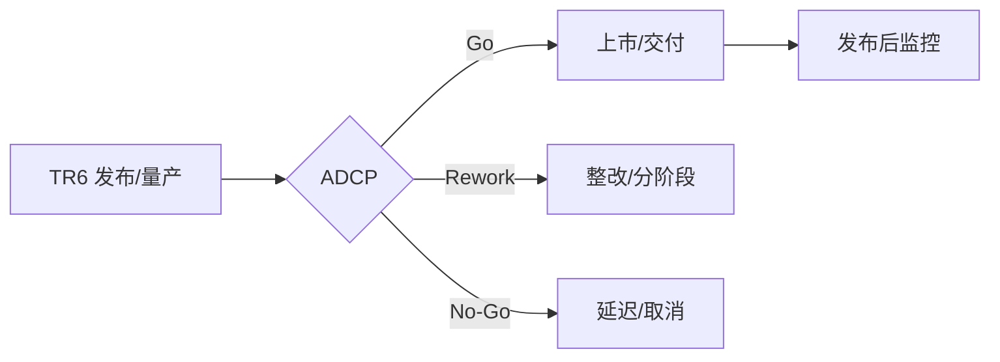

# 05. 发布阶段（TR6/ADCP）

> 完成上市/量产/交付/服务准备，通过 TR6 和 ADCP 获得上市授权，建立发布后监控与回退机制。

## 0. 一图看懂

## 1. 阶段门禁

- **门禁**：TR6（技术评审）+ ADCP（商业决策）
- **准入**：TR5 通过、发布包/版本冻结、量产/交付就绪、市场/销售/定价就绪、服务/培训就绪、认证完成、回退方案批准。
- **准出**：发布门禁全过、首单/首台可交付、支持团队就绪、监控/回退就绪、剩余风险接受。

## 2. 重点抓什么

**本阶段重点**：发布计划/市场/定价、量产/供应/交付、服务/培训/文档、回退方案、ADCP 决策、发布后监控

| 必须抓住 | 容易漏掉 | 失败信号 |
|---|---|---|
| ✅ 发布门禁全过 ✅ 首单/首台可交付 ✅ 供应/服务就绪 ✅ 回退方案可执行 ✅ 剩余风险接受 | ⚠️ 只盯质量，漏供应/服务 ⚠️ 回退方案没演练 ⚠️ 渠道/培训未就绪 | 🚨 ADCP 前还在补认证 🚨 首单交付靠“特事特办” 🚨 发布后问题无人接 |

## 3. 本阶段物料

📄 模板 17 ｜ 📊 台账 7 ｜ ✅ 检查表 7 ｜ 🔄 SOP 4 ｜ 合计 35

| 编号 | 交付物 | 类型 | 等级 | 责任角色 | 用途 | 文件 |
|---|---|---|---|---|---|---|
| RL-T-01 | 发布计划 | 📄 模板 | 🔴 M / 强制必选 | 发布经理 | 统筹发布范围、时间、渠道、角色、风险和回退。 | [模板/RL-T-01-发布计划.md](模板/RL-T-01-发布计划.md) |
| RL-T-02 | 市场推广与上市计划 | 📄 模板 | 🔴 M / 强制必选 | MKT | 明确定位、信息、渠道、预算、活动和度量。 | [模板/RL-T-02-市场推广与上市计划.md](模板/RL-T-02-市场推广与上市计划.md) |
| RL-T-03 | 销售与渠道准备计划 | 📄 模板 | 🟡 C / 条件可选 | 销售 | 准备销售工具、培训、渠道政策和目标。 | [模板/RL-T-03-销售与渠道准备计划.md](模板/RL-T-03-销售与渠道准备计划.md) |
| RL-T-04 | 定价策略与商务方案 | 📄 模板 | 🔴 M / 强制必选 | MKT/FIN | 明确定价、折扣、合同、付款和毛利。 | [模板/RL-T-04-定价策略与商务方案.md](模板/RL-T-04-定价策略与商务方案.md) |
| RL-T-05 | 生产爬坡/产能计划 | 📄 模板 | 🟡 C / 条件可选 | MFG | 明确产能、节拍、良率、爬坡和瓶颈。 | [模板/RL-T-05-生产爬坡-产能计划.md](模板/RL-T-05-生产爬坡-产能计划.md) |
| RL-T-06 | 供应链备货与交付计划 | 📄 模板 | 🟡 C / 条件可选 | SCM | 明确备货、交期、物流、库存和风险。 | [模板/RL-T-06-供应链备货与交付计划.md](模板/RL-T-06-供应链备货与交付计划.md) |
| RL-T-07 | 服务与支持准备计划 | 📄 模板 | 🔴 M / 强制必选 | SVC | 明确服务模式、SLA、备件、热线、培训和升级。 | [模板/RL-T-07-服务与支持准备计划.md](模板/RL-T-07-服务与支持准备计划.md) |
| RL-T-08 | 培训与赋能计划 | 📄 模板 | 🟡 C / 条件可选 | SVC/销售 | 明确培训对象、内容、方式、考核和计划。 | [模板/RL-T-08-培训与赋能计划.md](模板/RL-T-08-培训与赋能计划.md) |
| RL-T-09 | 产品发布说明 Release Notes | 📄 模板 | 🔴 M / 强制必选 | 产品/R&D | 说明版本内容、变更、已知问题、升级和回退。 | [模板/RL-T-09-产品发布说明-Release-Notes.md](模板/RL-T-09-产品发布说明-Release-Notes.md) |
| RL-T-10 | 产品手册/用户文档 | 📄 模板 | 🔴 M / 强制必选 | 产品/文档 | 指导安装、配置、使用、故障处理和安全。 | [模板/RL-T-10-产品手册-用户文档.md](模板/RL-T-10-产品手册-用户文档.md) |
| RL-T-11 | 媒体与公关材料 | 📄 模板 | 🟡 C / 条件可选 | MKT | 准备新闻稿、FAQ、口径和发言人。 | [模板/RL-T-11-媒体与公关材料.md](模板/RL-T-11-媒体与公关材料.md) |
| RL-T-12 | 发布风险评估与回退方案 | 📄 模板 | 🔴 M / 强制必选 | PDT/PQA | 识别发布风险、触发条件、回退步骤和责任人。 | [模板/RL-T-12-发布风险评估与回退方案.md](模板/RL-T-12-发布风险评估与回退方案.md) |
| RL-T-13 | 首发/首单检查表（模板） | 📄 模板 | 🔴 M / 强制必选 | 发布经理 | 确认首单/首台交付条件、证据和签署。 | [模板/RL-T-13-首发-首单检查表（模板）.md](模板/RL-T-13-首发-首单检查表（模板）.md) |
| RL-T-14 | TR6 评审材料 | 📄 模板 | 🔴 M / 强制必选 | PDT | 汇总发布就绪证据、风险和结论。 | [模板/RL-T-14-TR6-评审材料.md](模板/RL-T-14-TR6-评审材料.md) |
| RL-T-15 | ADCP 汇报材料 | 📄 模板 | 🔴 M / 强制必选 | PDT经理 | 向 IPMT 呈现商业、质量、供应、市场、服务和风险。 | [模板/RL-T-15-ADCP-汇报材料.md](模板/RL-T-15-ADCP-汇报材料.md) |
| RL-T-16 | 发布后监控计划 | 📄 模板 | 🔴 M / 强制必选 | SVC/QA | 定义监控指标、频率、阈值、响应和升级。 | [模板/RL-T-16-发布后监控计划.md](模板/RL-T-16-发布后监控计划.md) |
| RL-T-17 | 收入与成本跟踪表 | 📄 模板 | 🟡 C / 条件可选 | FIN | 跟踪收入、成本、毛利和偏差。 | [模板/RL-T-17-收入与成本跟踪表.md](模板/RL-T-17-收入与成本跟踪表.md) |
| RL-R-01 | 发布检查台账 | 📊 台账 | 🔴 M / 强制必选 | 发布经理/PMO | 发布门禁项、责任人、状态和证据。 | [台账/RL-R-01-发布检查台账.md](台账/RL-R-01-发布检查台账.md) |
| RL-R-02 | 上市问题台账 | 📊 台账 | 🔴 M / 强制必选 | 发布经理 | 上市问题、影响、措施和闭环。 | [台账/RL-R-02-上市问题台账.md](台账/RL-R-02-上市问题台账.md) |
| RL-R-03 | 订单/交付台账 | 📊 台账 | 🟡 C / 条件可选 | 销售/SCM | 订单、交付和履约。 | [台账/RL-R-03-订单-交付台账.md](台账/RL-R-03-订单-交付台账.md) |
| RL-R-04 | 客户反馈台账 | 📊 台账 | 🔴 M / 强制必选 | MKT/SVC | 反馈、投诉、满意度和闭环。 | [台账/RL-R-04-客户反馈台账.md](台账/RL-R-04-客户反馈台账.md) |
| RL-R-05 | 风险登记册 | 📊 台账 | 🔴 M / 强制必选 | PQA/PDT | 发布及上市风险。 | [台账/RL-R-05-风险登记册.md](台账/RL-R-05-风险登记册.md) |
| RL-R-06 | 问题日志 | 📊 台账 | 🔴 M / 强制必选 | PDT经理 | 滚动更新问题。 | [台账/RL-R-06-问题日志.md](台账/RL-R-06-问题日志.md) |
| RL-R-07 | 版本/发布台账 | 📊 台账 | 🔴 M / 强制必选 | CM/发布经理 | 版本、发布范围、时间和责任人。 | [台账/RL-R-07-版本-发布台账.md](台账/RL-R-07-版本-发布台账.md) |
| RL-C-01 | TR6 检查表 | ✅ 检查表 | 🔴 M / 强制必选 | PQA/各领域 | 检查发布包、量产/交付、供应链、质量、认证、文档、服务和回退是否就绪。 | [检查表/RL-C-01-TR6-检查表.md](检查表/RL-C-01-TR6-检查表.md) |
| RL-C-02 | 量产就绪检查表 | ✅ 检查表 | 🟡 C / 条件可选 | MFG/QA | 检查产能、良率、物料、工艺、设备和质量。 | [检查表/RL-C-02-量产就绪检查表.md](检查表/RL-C-02-量产就绪检查表.md) |
| RL-C-03 | 上市就绪检查表 | ✅ 检查表 | 🔴 M / 强制必选 | MKT/PMO | 检查市场、销售、渠道、定价、服务、文档和合规。 | [检查表/RL-C-03-上市就绪检查表.md](检查表/RL-C-03-上市就绪检查表.md) |
| RL-C-04 | 发布放行检查表 | ✅ 检查表 | 🔴 M / 强制必选 | 发布经理/PQA | 检查所有门禁、责任人、证据、签署和回退。 | [检查表/RL-C-04-发布放行检查表.md](检查表/RL-C-04-发布放行检查表.md) |
| RL-C-05 | 文档齐套检查表 | ✅ 检查表 | 🔴 M / 强制必选 | 产品/文档 | 检查手册、Release Notes、培训、服务、合规和归档。 | [检查表/RL-C-05-文档齐套检查表.md](检查表/RL-C-05-文档齐套检查表.md) |
| RL-C-06 | 服务就绪检查表 | ✅ 检查表 | 🔴 M / 强制必选 | SVC | 检查备件、工具、SLA、热线、培训和升级。 | [检查表/RL-C-06-服务就绪检查表.md](检查表/RL-C-06-服务就绪检查表.md) |
| RL-C-07 | 回退预案检查表 | ✅ 检查表 | 🔴 M / 强制必选 | PQA/发布经理 | 检查触发、步骤、责任人、时间、数据、沟通和演练。 | [检查表/RL-C-07-回退预案检查表.md](检查表/RL-C-07-回退预案检查表.md) |
| RL-S-01 | 发布管理 SOP | 🔄 SOP | 🔴 M / 强制必选 | 发布经理/PMO | 规范发布计划、门禁、TR6、ADCP、发布和监控。 | [SOP/RL-S-01-发布管理-SOP.md](SOP/RL-S-01-发布管理-SOP.md) |
| RL-S-02 | 量产爬坡 SOP | 🔄 SOP | 🟡 C / 条件可选 | MFG | 规范产能准备、爬坡、良率监控和移交。 | [SOP/RL-S-02-量产爬坡-SOP.md](SOP/RL-S-02-量产爬坡-SOP.md) |
| RL-S-03 | 上市营销 SOP | 🔄 SOP | 🟡 C / 条件可选 | MKT | 规范上市计划、物料、渠道、活动和复盘。 | [SOP/RL-S-03-上市营销-SOP.md](SOP/RL-S-03-上市营销-SOP.md) |
| RL-S-04 | 发布后监控与回退 SOP | 🔄 SOP | 🔴 M / 强制必选 | SVC/QA | 规范发布后监控、预警、响应、回退和复盘。 | [SOP/RL-S-04-发布后监控与回退-SOP.md](SOP/RL-S-04-发布后监控与回退-SOP.md) |

## 4. 使用提示

- 先读 `00-总览与使用说明/IPD流程总览.md` 和 `DCP与TR时序.md`；
- 用 `08-公共模板与规范/模板/CM-T-18-项目裁剪表.md` 做裁剪；
- 每份模板的“核心必填”栏目不得整体省略；
- DCP/TR 前用对应 `检查表/` 自检，问题闭环后再上会。
