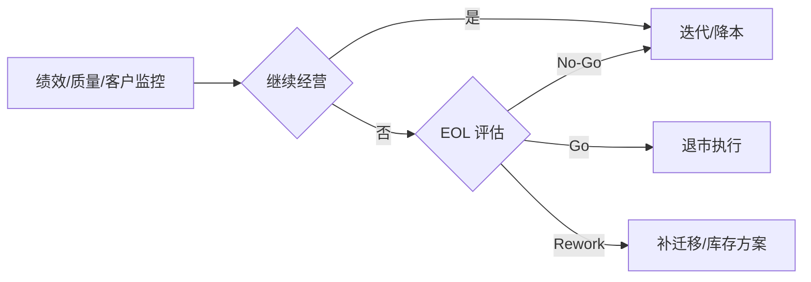

# 06. 生命周期与退市（LDCP/EOL）

> 监控产品绩效、质量、成本和客户满意度，持续优化，评估并执行退市，完成客户迁移、服务终止和知识沉淀。

## 0. 一图看懂

## 1. 阶段门禁

- **门禁**：PRR（上市后复盘）+ LDCP/EOL DCP（退市决策）
- **准入**：ADCP Go/产品上市、绩效指标/责任人/预算明确、退市触发条件定义、服务/合同/库存台账建立。
- **准出**：绩效达标或退市条件成立、客户迁移可行、库存/服务/合同风险可控、财务影响可接受。

## 2. 重点抓什么

**本阶段重点**：绩效/满意度/质量监控、版本迭代/降本、EOL 评估、客户迁移、库存/服务终止、复盘与归档

| 必须抓住 | 容易漏掉 | 失败信号 |
|---|---|---|
| ✅ 绩效/质量达标 ✅ 退市条件成立 ✅ 客户迁移可行 ✅ 库存/服务风险可控 ✅ 财务影响可接受 | ⚠️ 只算库存，不算客户流失 ⚠️ 服务合同未到期 ⚠️ 数据/知识未归档 | 🚨 绩效持续下滑 🚨 客户投诉集中 🚨 备件/服务成本失控 |

## 3. 本阶段物料

📄 模板 13 ｜ 📊 台账 7 ｜ ✅ 检查表 5 ｜ 🔄 SOP 4 ｜ 合计 29

| 编号 | 交付物 | 类型 | 等级 | 责任角色 | 用途 | 文件 |
|---|---|---|---|---|---|---|
| LC-T-01 | 产品绩效监控报告 | 📄 模板 | 🔴 M / 强制必选 | 产品/FIN | 监控收入、毛利、销量、份额、质量和满意度。 | [模板/LC-T-01-产品绩效监控报告.md](模板/LC-T-01-产品绩效监控报告.md) |
| LC-T-02 | 客户满意度与质量跟踪报告 | 📄 模板 | 🔴 M / 强制必选 | QA/SVC | 跟踪满意度、投诉、故障和改进。 | [模板/LC-T-02-客户满意度与质量跟踪报告.md](模板/LC-T-02-客户满意度与质量跟踪报告.md) |
| LC-T-03 | 版本迭代/路标规划 | 📄 模板 | 🟡 C / 条件可选 | 产品 | 规划版本、特性、时间和资源。 | [模板/LC-T-03-版本迭代-路标规划.md](模板/LC-T-03-版本迭代-路标规划.md) |
| LC-T-04 | 成本优化/降本计划 | 📄 模板 | 🟡 C / 条件可选 | FIN/SCM | 明确降本目标、措施、责任和收益。 | [模板/LC-T-04-成本优化-降本计划.md](模板/LC-T-04-成本优化-降本计划.md) |
| LC-T-05 | 退市评估报告 | 📄 模板 | 🔴 M / 强制必选 | 产品/FIN | 评估市场、销量、利润、客户、替代和风险。 | [模板/LC-T-05-退市评估报告.md](模板/LC-T-05-退市评估报告.md) |
| LC-T-06 | 退市计划 | 📄 模板 | 🔴 M / 强制必选 | 产品/PMO | 统筹退市时间表、范围、责任、沟通、库存、迁移和服务。 | [模板/LC-T-06-退市计划.md](模板/LC-T-06-退市计划.md) |
| LC-T-07 | 停产/停售通知 | 📄 模板 | 🔴 M / 强制必选 | MKT/销售 | 向客户/渠道发布停产停售信息。 | [模板/LC-T-07-停产-停售通知.md](模板/LC-T-07-停产-停售通知.md) |
| LC-T-08 | 库存清理与物料处置计划 | 📄 模板 | 🟡 C / 条件可选 | SCM | 明确库存、处置方式、损失和责任。 | [模板/LC-T-08-库存清理与物料处置计划.md](模板/LC-T-08-库存清理与物料处置计划.md) |
| LC-T-09 | 客户迁移方案 | 📄 模板 | 🔴 M / 强制必选 | MKT/SVC | 保障客户平滑迁移到替代产品。 | [模板/LC-T-09-客户迁移方案.md](模板/LC-T-09-客户迁移方案.md) |
| LC-T-10 | 服务终止/支持计划 | 📄 模板 | 🔴 M / 强制必选 | SVC | 明确支持期限、备件、升级和终止安排。 | [模板/LC-T-10-服务终止-支持计划.md](模板/LC-T-10-服务终止-支持计划.md) |
| LC-T-11 | 数据归档与知识沉淀清单 | 📄 模板 | 🔴 M / 强制必选 | PMO/PQA | 明确归档范围、位置、责任人、保留期和权限。 | [模板/LC-T-11-数据归档与知识沉淀清单.md](模板/LC-T-11-数据归档与知识沉淀清单.md) |
| LC-T-12 | 项目复盘报告 | 📄 模板 | 🔴 M / 强制必选 | PDT/PMO | 总结目标达成、偏差、原因、经验和改进。 | [模板/LC-T-12-项目复盘报告.md](模板/LC-T-12-项目复盘报告.md) |
| LC-T-13 | LDCP/EOL DCP 材料 | 📄 模板 | 🔴 M / 强制必选 | PDT/产品 | 向 IPMT 呈现退市评估、计划和风险。 | [模板/LC-T-13-LDCP-EOL-DCP-材料.md](模板/LC-T-13-LDCP-EOL-DCP-材料.md) |
| LC-R-01 | 产品绩效台账 | 📊 台账 | 🔴 M / 强制必选 | 产品经理 | 收入、毛利、销量、份额、质量和满意度。 | [台账/LC-R-01-产品绩效台账.md](台账/LC-R-01-产品绩效台账.md) |
| LC-R-02 | 客户反馈/投诉台账 | 📊 台账 | 🔴 M / 强制必选 | SVC/QA | 反馈、投诉、处理和满意度。 | [台账/LC-R-02-客户反馈-投诉台账.md](台账/LC-R-02-客户反馈-投诉台账.md) |
| LC-R-03 | 退市物料/库存台账 | 📊 台账 | 🟡 C / 条件可选 | SCM | 物料、成品、在途和处置。 | [台账/LC-R-03-退市物料-库存台账.md](台账/LC-R-03-退市物料-库存台账.md) |
| LC-R-04 | 版本/补丁台账 | 📊 台账 | 🔴 M / 强制必选 | R&D/CM | 版本、补丁、兼容和支持状态。 | [台账/LC-R-04-版本-补丁台账.md](台账/LC-R-04-版本-补丁台账.md) |
| LC-R-05 | 风险登记册 | 📊 台账 | 🔴 M / 强制必选 | PQA/产品 | 生命周期风险。 | [台账/LC-R-05-风险登记册.md](台账/LC-R-05-风险登记册.md) |
| LC-R-06 | 问题日志 | 📊 台账 | 🔴 M / 强制必选 | 产品经理 | 滚动更新问题。 | [台账/LC-R-06-问题日志.md](台账/LC-R-06-问题日志.md) |
| LC-R-07 | 合同/服务到期台账 | 📊 台账 | 🟡 C / 条件可选 | 销售/LEGAL/SVC | 合同、SLA、到期和续约。 | [台账/LC-R-07-合同-服务到期台账.md](台账/LC-R-07-合同-服务到期台账.md) |
| LC-C-01 | 生命周期健康检查表 | ✅ 检查表 | 🔴 M / 强制必选 | 产品/QA | 检查绩效、质量、成本、满意度、风险和合规。 | [检查表/LC-C-01-生命周期健康检查表.md](检查表/LC-C-01-生命周期健康检查表.md) |
| LC-C-02 | EOL 决策检查表 | ✅ 检查表 | 🔴 M / 强制必选 | IPMT/产品 | 检查市场、财务、客户、库存、服务、合规和替代。 | [检查表/LC-C-02-EOL-决策检查表.md](检查表/LC-C-02-EOL-决策检查表.md) |
| LC-C-03 | 退市执行检查表 | ✅ 检查表 | 🔴 M / 强制必选 | PMO/产品 | 检查通知、库存、迁移、服务、归档和预算。 | [检查表/LC-C-03-退市执行检查表.md](检查表/LC-C-03-退市执行检查表.md) |
| LC-C-04 | 项目复盘检查表 | ✅ 检查表 | 🔴 M / 强制必选 | PMO | 检查目标、过程、结果、经验、改进和跟踪。 | [检查表/LC-C-04-项目复盘检查表.md](检查表/LC-C-04-项目复盘检查表.md) |
| LC-C-05 | 数据归档检查表 | ✅ 检查表 | 🔴 M / 强制必选 | PMO/IT | 检查完整性、命名、权限、保留和备份。 | [检查表/LC-C-05-数据归档检查表.md](检查表/LC-C-05-数据归档检查表.md) |
| LC-S-01 | 生命周期管理 SOP | 🔄 SOP | 🔴 M / 强制必选 | 产品/PMO | 规范上市后监控、评估、迭代/维护和退出评估。 | [SOP/LC-S-01-生命周期管理-SOP.md](SOP/LC-S-01-生命周期管理-SOP.md) |
| LC-S-02 | EOL 退市 SOP | 🔄 SOP | 🔴 M / 强制必选 | 产品/PMO | 规范退市评估、决策、计划、通知、执行和归档。 | [SOP/LC-S-02-EOL-退市-SOP.md](SOP/LC-S-02-EOL-退市-SOP.md) |
| LC-S-03 | 产品绩效监控 SOP | 🔄 SOP | 🔴 M / 强制必选 | 产品/FIN | 规范绩效数据采集、分析、报告和行动。 | [SOP/LC-S-03-产品绩效监控-SOP.md](SOP/LC-S-03-产品绩效监控-SOP.md) |
| LC-S-04 | 项目复盘 SOP | 🔄 SOP | 🔴 M / 强制必选 | PMO | 规范复盘准备、会议、报告和改进跟踪。 | [SOP/LC-S-04-项目复盘-SOP.md](SOP/LC-S-04-项目复盘-SOP.md) |

## 4. 使用提示

- 先读 `00-总览与使用说明/IPD流程总览.md` 和 `DCP与TR时序.md`；
- 用 `08-公共模板与规范/模板/CM-T-18-项目裁剪表.md` 做裁剪；
- 每份模板的“核心必填”栏目不得整体省略；
- DCP/TR 前用对应 `检查表/` 自检，问题闭环后再上会。
