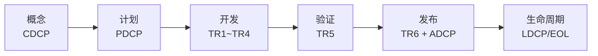

# IPD 产品开发交付物模板库

> 按 **IPD 六阶段** 进行目录结构划分，每个阶段中存放有该阶段要用的模板、台账、检查表和 SOP。共 **278 份** 交付物。

---

## 0. 一图看懂



> 每个阶段先看“门禁 + 检查表”，再决定“模板填多细”。完整视觉版见 [`00-总览与使用说明/一页看懂IPD.md`](00-总览与使用说明/一页看懂IPD.md)。
>
> 图示使用 Mermaid，GitHub / VS Code（安装 Markdown Preview Mermaid 插件）可直接渲染；不支持时看 `99-附件/` 下的 SVG。

## 1. 先看哪里

| 顺序 | 文件 | 作用 |
|---|---|---|
| 0 | [`00-总览与使用说明/一页看懂IPD.md`](00-总览与使用说明/一页看懂IPD.md) | **先看这个**：六阶段图、双轨图、三色门禁、裁剪决策树、十条铁律 |
| 1 | [`00-总览与使用说明/IPD流程总览.md`](00-总览与使用说明/IPD流程总览.md) | 六阶段、DCP/TR 双轨、门禁、常见失败模式 |
| 2 | [`00-总览与使用说明/DCP与TR时序.md`](00-总览与使用说明/DCP与TR时序.md) | 每个 DCP/TR 的输入、输出、证据、时限 |
| 3 | [`00-总览与使用说明/角色与RACI.md`](00-总览与使用说明/角色与RACI.md) | 谁负责、谁批准、谁被咨询 |
| 4 | [`00-总览与使用说明/文件分级与裁剪指南.md`](00-总览与使用说明/文件分级与裁剪指南.md) | 哪些文件必做、哪些可裁剪、模板里哪些栏目不能省 |
| 5 | [`00-总览与使用说明/全量交付物索引.md`](00-总览与使用说明/全量交付物索引.md) | 278 份交付物的完整清单和链接 |

---

## 2. 仓库结构

```text
ipd-product-management-templates/
├── README.md
├── 00-总览与使用说明/          # 流程、时序、角色、分级、裁剪、总索引
├── 01-概念阶段-CDCP/           # 25 份：模板/台账/检查表/SOP
├── 02-计划阶段-PDCP/           # 38 份
├── 03-开发阶段-TR1-TR4/        # 51 份
├── 04-验证阶段-TR5/            # 33 份
├── 05-发布阶段-TR6-ADCP/       # 35 份
├── 06-生命周期与退市/          # 29 份
├── 07-顶层治理/                # 43 份（跨项目制度、IPMT/PDT/PQA/变更/基线等）
├── 08-公共模板与规范/          # 24 份（会议纪要、风险台账、归档/基线规范等）
├── 09-示例/                    # 填写样例（不是模板）
├── 99-附件/                    # 流程图/时序图
├── scripts/                    # catalog + 生成器 + 索引生成器
└── .github/                    # 贡献指南、PR/Issue 模板
```

### 阶段文件夹结构

```text
01-概念阶段-CDCP/
├── README.md          # 本阶段目标、门禁、物料清单
├── 模板/              # 要填的文档，如 CP-T-01-项目立项申请书.md
├── 台账/              # 动态登记表，如 CP-R-03-风险登记册.md
├── 检查表/            # DCP/TR 自检清单，如 CP-C-01-CDCP决策检查表.md
└── SOP/               # 本阶段流程，如 CP-S-01-机会点识别与立项SOP.md
```

> 文件名统一为 `编号-中文名称.md`。编号里的 `T/R/C/S` 分别代表模板/台账Register/Checklist/SOP。

---

## 3. 六阶段与门禁

| 阶段文件夹 | 商业决策 | 技术评审 | 核心问题 |
|---|---|---|---|
| `01-概念阶段-CDCP` | **CDCP** | Pre-TR1 | 值不值得做？大致做什么？ |
| `02-计划阶段-PDCP` | **PDCP** | TR1 准入预审 | 怎么做？投多少？谁来做？ |
| `03-开发阶段-TR1-TR4` | 无独立 DCP（重大变更触发 IDCP） | **TR1~TR4** | 设计对不对？能不能做出来？ |
| `04-验证阶段-TR5` | 无独立 DCP（LRR 发布准入预审） | **TR5** | 做出来的对不对？能不能发布？ |
| `05-发布阶段-TR6-ADCP` | **ADCP** | **TR6** | 能不能卖？能不能交付？ |
| `06-生命周期与退市` | **LDCP/EOL DCP** | PRR 上市后复盘 | 继续投入还是退市？ |

> TR1 按“开发阶段入口”组织；概念阶段用 Pre-TR1，计划阶段完成 TR1 准入预审。

---

## 4. 文件等级：先决定“要不要做”，再决定“写多细”

| 等级 | 代码 | 含义 | 不产出后果 |
|---|---|---|---|
| 强制必选 | **M** | 不做则对应 DCP/TR 不得进入或不得通过 | 门禁不通过 |
| 条件可选 | **C** | 满足括号内场景才需要；不适用时记录理由 | PQA 审核 + PDT 经理批准 |
| 非必要 | **O** | 仅 A 类/复杂/高风险项目增值 | 不影响门禁 |

**裁剪三条红线**：

1. DCP/TR 的硬性输入不得裁剪；
2. 质量、成本、风险、验收标准、升级路径五类栏目不得整体省略；
3. 裁剪必须有替代控制措施，不能只写“不适用”。

详见 [`00-总览与使用说明/文件分级与裁剪指南.md`](00-总览与使用说明/文件分级与裁剪指南.md) 和 [`00-总览与使用说明/项目分级与裁剪.md`](00-总览与使用说明/项目分级与裁剪.md)。

---

## 5. 怎么用

### 5.1 新项目立项

1. 打开 `01-概念阶段-CDCP/README.md`，按清单准备；
2. 复制 `模板/CP-T-01-项目立项申请书.md` 到项目库填写；
3. 用 `检查表/CP-C-01-CDCP决策检查表.md` 自检；
4. 用 `模板/CP-T-12-CDCP汇报材料.md` 上会；
5. CDCP Go 后进入 `02-计划阶段-PDCP/`。

### 5.2 每个 DCP/TR 前

- 先看 `00-总览与使用说明/DCP与TR时序.md` 确认节点和材料；
- 用对应阶段的 `检查表/` 逐项打勾；
- 红色/阻断问题闭环后再上会；
- 会议纪要、决策记录用 `08-公共模板与规范/模板/` 下的通用模板。

### 5.3 小项目裁剪

- 先读 `00-总览与使用说明/项目分级与裁剪.md`；
- 用 `08-公共模板与规范/模板/CM-T-18-项目裁剪表.md` 逐项记录“适用/不适用/简化”；
- 不适用必须写理由和替代控制，不能只写“项目小”。

### 5.4 项目结束

- 按 `08-公共模板与规范/规范/CM-A-01-归档规范.md` 归档；
- 用 `06-生命周期与退市/` 下的复盘模板做复盘；
- 把可复用经验回写到本仓库。

---

## 6. 每份正文包含什么

### 模板
文档控制表、目的与用途、适用范围与触发条件、RACI、**核心必填/推荐/可省略**三级栏目、每个核心栏目的填写要求与填写区、风险与依赖、验收标准、评审与审批、变更记录、附录。

### 台账
字段定义、状态流、可直接填写的台账表、复盘与升级规则、验收标准。

### Checklist
强制检查项 M1...、可选补充项 O1...、判定标准、证据、结论、整改人/期限、复核人、检查结论。

### SOP
触发条件、流程步骤（输入/活动/输出/责任人/时限）、评审/决策节点、例外与兜底、SLA、度量与审计。

---

## 7. 命名、版本与归档

### 文件命名

```text
{编号}-{中文名称}.md
```

示例：

- `CP-T-01-项目立项申请书.md`
- `DV-C-01-TR1检查表.md`
- `GV-S-09-变更管理SOP.md`

### 版本规则

| 版本 | 含义 | 触发 |
|---|---|---|
| V0.x | 草稿 | 起草/讨论 |
| V1.0 | 首次批准 | DCP/TR 通过或项目基线 |
| V1.x | 小修 | 文字、附件、非关键澄清 |
| V2.0 | 大修 | 范围、结论、基线、责任重大变化 |

### 归档

- 每个 DCP/TR 后归档一次；
- 项目结束后全量归档；
- 归档包含：批准版、评审记录、行动项闭环、台账快照；
- 默认保留不少于 5 年，法规另有要求从其规定。

---

## 8. 生成与维护

```bash
# 重新生成 278 份正文
python scripts/generate_docs.py

# 重新生成总索引和各阶段 README
python scripts/generate_index.py
```

新增/修改交付物时，优先改 `scripts/catalog/*.txt`，再运行上面两个命令，避免手工改 278 份文件导致格式漂移。详见 [`scripts/README.md`](scripts/README.md)。

---

## 9. 贡献

1. 新增/修改模板必须走 PR；
2. PR 说明：改了什么、为什么、影响哪些阶段/角色、是否影响 DCP/TR 门禁；
3. 涉及门禁的修改，需 PQA/PMO 评审；
4. 不得删除“核心必填”栏目；
5. 提交前运行生成脚本并检查 diff。

详见 [`.github/CONTRIBUTING.md`](.github/CONTRIBUTING.md)。

---

## 10. 常见问题

**Q：小项目也要写这么多吗？**  
A：不用。先看文件等级，再看模板内部的核心/推荐/可省略。C 类项目只保留 M + 关键 C，O 类直接省略；但裁剪必须记录并经 PQA 审核。

**Q：模板和样例的区别？**  
A：各阶段文件夹里的是模板；`09-示例/项目立项申请书-填写样例.md` 是填好内容的样例，只用于参考。

**Q：DCP 和 TR 有什么区别？**  
A：DCP 是商业决策（做不做、投不投、卖不卖），由 IPMT 决策；TR 是技术评审（设计对不对、能不能做/验证/发布），由技术评审组评审。两者双轨并行，不能互相替代。

**Q：TR1 到底在概念还是开发？**  
A：不同公司有差异。本库按“开发阶段 TR1~TR4”组织；概念阶段用 Pre-TR1 支撑 CDCP，计划阶段完成 TR1 准入预审。

---

## 11. 版本与许可

- 当前版本：V1.1（2026-10-23，按阶段重构目录）
- 维护：PMO / IPD 体系建设负责人
- 许可：[](https://creativecommons.org/licenses/by-nc-sa/4.0/) ipd‑pdt‑toolkit © 2026 by Calanthe


> **免责声明**：本仓库提供通用模板，不构成法律、合规、财务或行业监管建议。涉及具体法规、合同、认证时，必须由公司法务/合规/质量部门确认。
